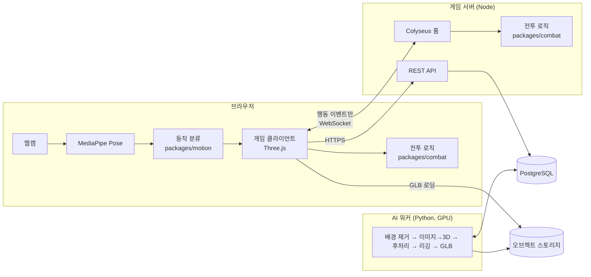

# Motion Boxing Arena

> **"내가 만든 캐릭터가 내 움직임대로 싸우는 AI 모션 복싱 게임"**

웹캠으로 실제 펀치·가드·회피 동작을 인식하고, 2D 그림으로 만든 3D 캐릭터로
AI 또는 다른 사용자와 **1인칭 복싱**을 하는 웹 기반 3D 게임입니다.

> **현재 상태 (2026-10-12): MVP -1 ~ 3 구현** · 웹 데모 → <https://jngbnss.github.io/motion-boxing-arena/>
> 공개 데모는 정적 배포라 AI 대전·T0 스킨만 동작합니다. 온라인 1:1과 AI 3D 생성은 게임 서버·GPU 워커가 필요하며, 아직 공개 호스팅이 없어 로컬에서 실행합니다(아래). 설계 문서는 [`docs/`](docs/)에 있습니다.

## 로컬 실행

```sh
pnpm install
pnpm dev:server   # 게임 서버 :2567 (REST /api/v1, Colyseus duel 룸, 내장 PGlite DB, 파일은 apps/server/.data)
pnpm dev          # 웹 :5173 (VITE_API_URL 기본 http://localhost:2567; 웹캠은 localhost 또는 HTTPS에서만 동작)
pnpm test         # combat · motion · server · web 테스트
pnpm typecheck
```

- **온라인 1:1**: 로비 → 방 만들기 → 초대 링크(`?room=CODE`)를 다른 탭/PC에서 열기. 같은 브라우저 두 탭은 게스트 세션(localStorage)을 공유합니다.
- **서버 환경 변수**: `PORT`, `DATA_DIR`, `DATABASE_URL`(없으면 PGlite), `PUBLIC_BASE_URL`, `CORS_ORIGINS`, `AUTH_SECRET`, `WORKER_SECRET`, `SIM_LATENCY_MS`/`SIM_JITTER_MS`(지연 재현), `REWIND_GRACE_MS`. 배포용 `apps/server/Dockerfile` 포함.
- **정적 빌드에서 서버 연결**: `VITE_API_URL=https://<서버> pnpm --filter @mba/web build`. 비우면 온라인·생성 UI는 "서버 미설정"으로 비활성화됩니다.

### AI 생성 워커 (`workers/ai`)

Python 3.12 + [uv](https://docs.astral.sh/uv/). 이미지 → 배경 제거(rembg) → TripoSR(MIT) 3D 메쉬 → 정리·정규화(키 1.8 m, +Y up, 정면 +Z) → `mba-humanoid-v1` 22본 템플릿 리깅 → 검증(T2 smooth / T1 rigid, 실패 시 웹은 T0 유지) → 스킨 GLB + 썸네일 + 팔레트.

```sh
cd workers/ai
uv sync                      # CUDA 13.0 torch(드라이버 ≥ 580). CUDA가 없으면 CPU로 동작(느림)
uv run pytest -q             # 순수 로직 테스트 (GPU 불필요)
uv run mba-worker --api http://localhost:2567 --secret dev-worker-secret   # 서버 작업 처리 (2초 폴링)
uv run mba-worker once --image samples/boxer_apose.png --out out/boxer.glb  # 서버 없이 1장 처리
```

- RTX 4050 6GB 기준 작업당 약 12초(모델 로드 약 17초는 시작 시 1회), VRAM 피크 약 3 GiB. 첫 실행은 TripoSR·U²-Net·MediaPipe 가중치를 내려받습니다.
- 좋은 입력: 정면·전신·팔이 몸통에서 떨어진 A/T 포즈, 단순한 배경. 팔이 몸에 붙은 그림은 T1(rigid), 비정형 포즈는 실패(T0)가 됩니다.

`main` 푸시마다 GitHub Actions가 CI(타입체크·테스트·빌드)를 돌리고 GitHub Pages에 웹을 배포합니다.

---

## 핵심 기능 (계획)

| 기능 | 설명 | MVP |
|---|---|---|
| 🥊 1인칭 3D 복싱 | 브라우저에서 상대 캐릭터와 자기 글러브를 보며 대전 | 필수 |
| 📷 웹캠 모션 인식 | MediaPipe Pose로 잽·스트레이트·가드·좌우 회피 인식 (브라우저 로컬 처리, 영상 미전송) | 필수 |
| 🤖 AI 상대 | FSM 기반 게임 AI, Easy / Normal / Hard | 필수 |
| 🎨 캐릭터 생성 | 2D 이미지 → 3D 메쉬 → 공통 스켈레톤 리깅 → 게임 투입. 실패 시 스킨 모드로 대체 | 범위 조정 가능 |
| 🌐 온라인 1:1 | 초대 링크로 친구와 실시간 대전, 서버 권한 판정 | 범위 조정 가능 |

## 사용자 시나리오

1. 사이트에 접속해 기본 캐릭터를 고르거나, 직접 그린 그림을 업로드합니다.
2. AI가 그림을 3D 캐릭터로 바꾸는 동안(수십 초~수 분) 바로 AI 상대와 한 판 할 수 있습니다.
3. 웹캠 캘리브레이션(약 30초): 기본 자세, 가드, 펀치·회피 테스트.
4. 1인칭 시점에서 실제로 주먹을 뻗으면 캐릭터가 펀치를 날리고, 상대의 예비동작을 보고 **고개를 젖히면 회피**합니다.
5. KO 또는 시간 종료 → 결과 화면(명중률, 회피 성공률, 펀치 수, 경기 시간) → 재대결.

## 주요 기술 (계획, 버전은 2026-10-12 npm 기준)

| 영역 | 기술 |
|---|---|
| 프론트엔드 | Vite 8, TypeScript, React 19 (UI), Three.js r186 (게임) |
| 모션 인식 | @mediapipe/tasks-vision 1.1.0 (Pose Landmarker lite/full) |
| 판정·물리 | 자체 결정적 전투 로직(공유 패키지), Rapier 0.21은 연출용(선택) |
| 실시간 | Colyseus 0.18 + @colyseus/sdk 0.18 |
| 백엔드 | Node.js + TypeScript, Fastify, PostgreSQL |
| AI 3D 생성 | Python 워커. 이미지→3D 모델은 TRELLIS / TRELLIS.2 / SPAR3D / TripoSR 중 **PoC로 선정**. 자동 리깅은 Make-It-Animatable 또는 UniRig. 후처리는 Blender |
| 저장소 | PostgreSQL, S3 호환 오브젝트 스토리지 (MinIO / Cloudflare R2) |
| 배포 | 정적 프론트(GitHub Pages 또는 Cloudflare Pages) + 게임 서버 VM + GPU 워커 |

> Tencent Hunyuan3D 계열은 라이선스 적용 지역에서 대한민국을 제외하므로 **사용하지 않습니다.** ([근거](docs/14-OPEN-SOURCE-LICENSES.md))

## 시스템 아키텍처



- **웹캠 영상은 브라우저 밖으로 나가지 않습니다.** 네트워크로는 `jab`, `guard` 같은 행동 이벤트와 머리 위치만 전송됩니다.
- 싱글플레이와 서버가 **같은 전투 로직 패키지**를 사용해 판정 불일치를 막습니다.
- 모든 캐릭터는 공통 스켈레톤 하나로 움직이며, 타격 판정 영역은 외형과 무관하게 동일합니다.

상세: [docs/02-SYSTEM-ARCHITECTURE.md](docs/02-SYSTEM-ARCHITECTURE.md)

## MVP 단계

| 단계 | 내용 | 상태 |
|---|---|---|
| MVP -1 | 모노레포, 공유 계약(타입·스키마) 동결 | 완료 |
| MVP 0 | 3D 경기장, 기본 복서, 키보드 조작, 타격 판정, AI 상대 | 완료 |
| MVP 1 | 웹캠 인식(잽·스트레이트·가드·좌우 회피), 캘리브레이션, 스킨 모드 | 완료 |
| MVP 2 | 온라인 1:1, 게임 룸, 서버 판정, 재접속 | 완료 (로컬 서버, 공개 호스팅 미정) |
| MVP 3 | 이미지 업로드, AI 3D 생성, 리깅, 게임 적용 | 완료 (로컬 GPU 워커, TripoSR) |
| MVP 4 | 정확도·성능 개선 측정, UX, 테스트 자동화 | 계획 |
| 확장 | 훅·어퍼컷·숙이기, 랭킹, 종목 확장, 홀로그램 출력 | 범위 밖 |

## 개발 계획 (8주, 7명)

| 주 | 목표 |
|---|---|
| W1 | 계약 동결 + 기술 PoC 4종(모션, 이미지→3D, 리깅, 네트워크) |
| W2 | 키보드 게임 완성, 3D 생성 Go/No-Go |
| W3 | **웹캠으로 AI 상대 1경기 완주 (핵심 경로)** |
| W4 | 데이터셋·평가, 서버 판정, 생성 워커 E2E |
| W5 | 온라인 대전, 생성 UI |
| W6 | 생성 캐릭터 적용, 인식·성능 개선 |
| W7 | 기능 동결, 측정, 배포 |
| W8 | 안정화, 시연 리허설 |

상세: [docs/11-MVP-ROADMAP.md](docs/11-MVP-ROADMAP.md), 작업 분해: [docs/15-DEVELOPMENT-TASKS.md](docs/15-DEVELOPMENT-TASKS.md)

## 오픈소스 활용 계획

| 용도 | 오픈소스 | 라이선스 |
|---|---|---|
| 3D 렌더링 | Three.js | MIT |
| 포즈 추정 | MediaPipe Tasks Vision | Apache-2.0 |
| 실시간 서버 | Colyseus | MIT |
| 물리 연출(선택) | Rapier | Apache-2.0 |
| 이미지→3D (후보) | TRELLIS / TRELLIS.2, TripoSR / SPAR3D | MIT / MIT(의존성 확인 필요) / Stability Community |
| 자동 리깅 (후보) | Make-It-Animatable, UniRig | MIT |
| 메쉬 후처리 | Blender (별도 프로세스) | GPL-3.0 |
| 애니메이션 | Quaternius Universal Animation Library | CC0 |

전체 검토: [docs/14-OPEN-SOURCE-LICENSES.md](docs/14-OPEN-SOURCE-LICENSES.md)

## 문서

| 문서 | 내용 |
|---|---|
| [00 개요](docs/00-PROJECT-OVERVIEW.md) | 목표, 원칙, AI 활용 범위 |
| [01 사용자 플로우](docs/01-USER-FLOW.md) | 10단계 플로우 |
| [02 시스템 아키텍처](docs/02-SYSTEM-ARCHITECTURE.md) | 구성요소, 다이어그램 |
| [03 기술 스택](docs/03-TECH-STACK.md) | 후보 분석, 버전 |
| [04 AI 3D 파이프라인](docs/04-AI-3D-PIPELINE.md) | 2D→3D→리깅 |
| [05 모션 인식](docs/05-MOTION-RECOGNITION.md) | MediaPipe, 분류 알고리즘 |
| [06 전투 시스템](docs/06-COMBAT-SYSTEM.md) | 1인칭, 판정, AI 상대 |
| [07 멀티플레이어](docs/07-MULTIPLAYER.md) | 동기화, 서버 권한 |
| [08 API 설계](docs/08-API-DESIGN.md) | REST, 실시간 이벤트 |
| [09 데이터 모델](docs/09-DATA-MODEL.md) | ERD |
| [10 UI/UX](docs/10-UI-UX.md) | 화면 설계 |
| [11 MVP 로드맵](docs/11-MVP-ROADMAP.md) | 8주 계획 |
| [12 성능·테스트](docs/12-PERFORMANCE-TESTING.md) | 지표, 실험 |
| [13 위험](docs/13-RISKS.md) | 위험 분석 |
| [14 라이선스](docs/14-OPEN-SOURCE-LICENSES.md) | 오픈소스 검토 |
| [15 개발 작업](docs/15-DEVELOPMENT-TASKS.md) | 작업 분해, 체크리스트 |
| [결정 기록](docs/designs/motion-boxing-arena.md) | 모든 설계 결정의 근거 |

## 안전 안내

실제로 팔을 휘두르는 게임입니다. 플레이 전 주변 1.5m × 1.5m 공간을 비우고, 모니터·벽과 거리를 두세요. 게임은 캘리브레이션 단계에서 공간 확인을 안내합니다.
