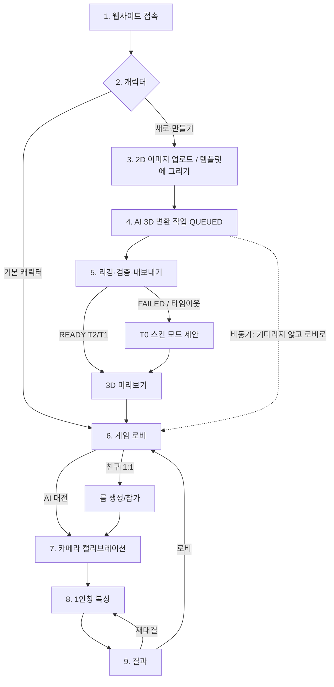

# 01. 사용자 플로우 설계

> 기준 문서: [designs/motion-boxing-arena.md](designs/motion-boxing-arena.md) (계약 C1~C9).
> 이 문서는 **설계**이며 구현된 기능은 아직 없다.

## 1. 전체 흐름

핵심 시연 경로(굵은 선)는 `접속 → 기본/사전생성 캐릭터 선택 → 로비 → 캘리브레이션 → AI 대전 → 결과`이며, 3D 생성(3~5단계)과 온라인 대전은 이 경로를 막지 않도록 **비동기·선택 경로**로 설계한다.

## 2. 단계별 설계

### [1] 웹사이트 접속
| 항목 | 내용 |
|---|---|
| 화면 | 메인 화면(시작하기, 캐릭터 만들기, 설정) |
| 서버 처리 | `POST /api/guest` → 게스트 ID + 서명 토큰 발급(로컬 저장). 재방문 시 토큰 재사용 |
| AI 처리 | 없음. 백그라운드에서 MediaPipe WASM + `pose_landmarker_lite.task`(약 5.8MB) 프리페치 시작 |
| 오류 처리 | 브라우저 미지원(WebGL2/getUserMedia 없음) → 지원 브라우저 안내. HTTP 접속 → HTTPS 리다이렉트(웹캠은 보안 컨텍스트 필요). 서버 불가 → "오프라인 모드(AI 대전, 기본 캐릭터만)"로 진행 |
| 데이터 흐름 | 토큰: localStorage(try/catch, 실패 시 메모리) |

### [2] 캐릭터 생성 또는 기본 캐릭터 선택
| 항목 | 내용 |
|---|---|
| 화면 | 캐릭터 선택(기본 복서 3~4종 + 사전 생성 갤러리 + 내 캐릭터 + "새로 만들기") |
| 서버 처리 | `GET /api/characters?owner=me`, `GET /api/characters?visibility=public` |
| AI 처리 | 없음 |
| 오류 처리 | 목록 로드 실패 → 번들에 포함된 기본 캐릭터만 표시 |
| 데이터 흐름 | `CharacterManifest`(C5) 목록 → 썸네일 표시 → 선택 시 `selectedCharacterId` 저장 |

### [3] 2D 이미지 업로드
| 항목 | 내용 |
|---|---|
| 화면 | AI 캐릭터 생성 화면: (a) 파일 업로드 (b) **A-pose 실루엣 템플릿 캔버스에 직접 그리기** |
| 입력 유형 | 직접 그린 캐릭터, 로봇, 만화 캐릭터, 사람 형태. 정면·전신·팔 벌린 자세 권장 |
| 서버 처리 | `POST /api/uploads`(presigned URL 발급) → 클라이언트가 스토리지에 직접 업로드 → `POST /api/character-jobs` |
| 검증 | PNG/JPG/WebP, ≤ 10MB, 짧은 변 ≥ 512px, 이미지 해시로 중복 요청 감지, **권리 보유 확인 체크박스 필수** |
| AI 처리 | 클라이언트 사전 검사(선택): 이미지에 MediaPipe Pose를 1회 실행해 사람형 여부 힌트 표시(그림에서의 동작은 PoC 필요) |
| 오류 처리 | 형식/크기 오류 즉시 표시, 일일 생성 한도 초과 → T0 스킨 모드 안내 |
| 데이터 흐름 | 원본 이미지 → `uploads/{userId}/{hash}.png` → job 레코드 `QUEUED` |

### [4] AI 3D 변환
| 항목 | 내용 |
|---|---|
| 화면 | 생성 진행 화면(단계 표시: 전처리 → 생성 → 후처리 → 리깅 → 검증 → 내보내기), "기다리지 않고 로비로" 버튼 |
| 서버 처리 | job 상태 폴링 `GET /api/character-jobs/:id`(3초 간격) 또는 로비 알림 |
| AI 처리 | 워커: 배경 제거(rembg/BiRefNet) → 객체 크롭·정사각 패딩 → 이미지→3D 모델(PoC 선정: TRELLIS.2/TRELLIS/SPAR3D/TripoSR, 대체 Meshy API) → 메쉬 정리(부유물 제거, 데시메이션 ≤ 20k tris, 방향·스케일 정규화) → 텍스처 1024px |
| 오류 처리 | 단계별 `FAILED{stage, retryable, reason}`. 재시도 가능하면 "다시 시도(같은 단계부터)", 불가하면 T0 스킨 제안 |
| 데이터 흐름 | `jobs/{jobId}/{stage}/*` 산출물 저장 → 다음 단계 입력 |

### [5] 캐릭터 움직임 준비
| 항목 | 내용 |
|---|---|
| 화면 | 3D 미리보기(회전, 테스트 애니메이션 재생: idle/jab/straight/guard/hit, Tier 배지 T2/T1/T0) |
| 서버 처리 | job `READY` → `characters` 레코드 생성, `character.json`(C5) 저장 |
| AI 처리 | 공통 스켈레톤 `mba-humanoid-v1` 바인딩: smooth(Make-It-Animatable 또는 Blender 자동 가중치) → 검증 실패 시 rigid 분할 바인딩. 충돌 영역은 **스켈레톤 정규 히트 볼륨**(C3)으로 고정 생성 |
| 오류 처리 | 미리보기에서 사용자가 "관절이 이상해요" → rigid 재바인딩 요청(같은 job, RIGGING 단계부터) 또는 T0 |
| 데이터 흐름 | `character.glb` + `thumbnail.png` + `character.json` → CDN URL |

### [6] 게임 로비
| 항목 | 내용 |
|---|---|
| 화면 | 모드 선택(AI 대전: Easy/Normal/Hard, 친구와 1:1: 방 만들기/코드 입력), 캐릭터 변경, 웹캠 설정 바로가기, 생성 작업 알림 배지 |
| 서버 처리 | 친구 대전 시 Colyseus `duel` 룸 생성 → 6자리 룸 코드 + 초대 링크(`/?room=ABC123`) |
| AI 처리 | 없음 |
| 오류 처리 | 게임 서버 연결 실패 → 친구 대전 버튼 비활성 + "AI 대전은 가능" 안내 |
| 데이터 흐름 | `{mode, difficulty | roomId, characterId}` → 다음 단계 |

### [7] 카메라 캘리브레이션
| 항목 | 내용 |
|---|---|
| 화면 | 웹캠 설정 → 자세 캘리브레이션(디버그 오버레이 포함) |
| 순서 | 권한 요청 → 사용자 1명 검출 → 플레이 공간 안내(1.5m×1.5m) → 기본 자세 3초 → 가드 2초 → 잽/스트레이트/좌우 회피 각 3회 테스트 |
| 서버 처리 | 멀티: `calib:done` 전송 → 룸 상태 `calibrated=true` |
| AI 처리 | 브라우저 로컬 Pose Landmarker(VIDEO 모드). 사용자별 임계값 산출([05](05-MOTION-RECOGNITION.md)) |
| 오류 처리 | 권한 거부, 장치 없음, 조명 부족, 사람 미검출, 2인 검출, 손목 화면 이탈 → 각각 전용 안내([10](10-UI-UX.md)) |
| 데이터 흐름 | `CalibrationProfile`(로컬 저장, 서버 전송 안 함). 영상은 저장·전송하지 않음 |

### [8] 1인칭 복싱
| 항목 | 내용 |
|---|---|
| 화면 | 게임 플레이(상대 캐릭터, 내 글러브+전완, 링, HP, 타이머, 타격 효과, 작은 웹캠 인식 표시등) |
| 서버 처리 | AI 대전: 서버 불필요(packages/combat 로컬 실행). 멀티: 서버 권한 판정(C7) |
| AI 처리 | 매 프레임 포즈 추정 → 동작 분류 → `StrikeEvent`/`PoseState`(C2). 상대 AI는 FSM(생성형 AI 아님) |
| 오류 처리 | 추적 손실 2초 → 자동 일시정지, ESC/양손 머리 위 2초 → 일시정지, 상대 연결 끊김 → PAUSED(≤20s) |
| 데이터 흐름 | 펀치: 인식 → 이벤트 → 애니메이션 → active 판정 → HP 갱신 ([06](06-COMBAT-SYSTEM.md)) |

### [9] 게임 결과
| 항목 | 내용 |
|---|---|
| 화면 | 승/패/KO/판정, 명중률, 펀치 수(잽/스트레이트), 회피 성공률, 가드 성공 수, 경기 시간 |
| 서버 처리 | 멀티: 서버가 `matches` 레코드 저장 후 `match:end`에 matchId 포함. AI 대전: `POST /api/matches/local`(선택, 통계용) |
| 오류 처리 | 저장 실패 → 결과는 화면에 표시, "기록 저장 실패" 작은 경고 |
| 데이터 흐름 | 경기 중 집계된 `MatchStats` → 결과 화면 |

### [10] 재대결
| 항목 | 내용 |
|---|---|
| 화면 | 결과 화면의 "재대결" / "캐릭터 바꾸기" / "로비" |
| 서버 처리 | 멀티: 양쪽 `match:rematch` → 캘리브레이션 생략하고 `READY → COUNTDOWN` |
| 오류 처리 | 상대가 나감 → "상대가 떠났습니다" + 로비 이동 |
| 데이터 흐름 | 캘리브레이션 프로필 재사용. 새 캐릭터가 READY면 교체 제안 |

## 3. 시연 트릭: 경기 중 생성

1. 시연자가 그림을 업로드하고 즉시 "기다리지 않고 로비로"를 누른다.
2. 사전 생성 캐릭터로 AI(Normal)와 1라운드(90초)를 진행한다.
3. 결과 화면에서 "새 캐릭터가 준비되었습니다" 배지 → 재대결 시 새 캐릭터로 교체.
4. 생성이 끝나지 않았거나 실패하면 T0 스킨 캐릭터로 교체해 시연 흐름을 유지한다.

생성 평균 시간이 90초를 넘으면(PoC로 측정) 시연 순서를 "업로드 → 캘리브레이션 → 경기"로 바꿔 대기 시간을 더 확보한다.
