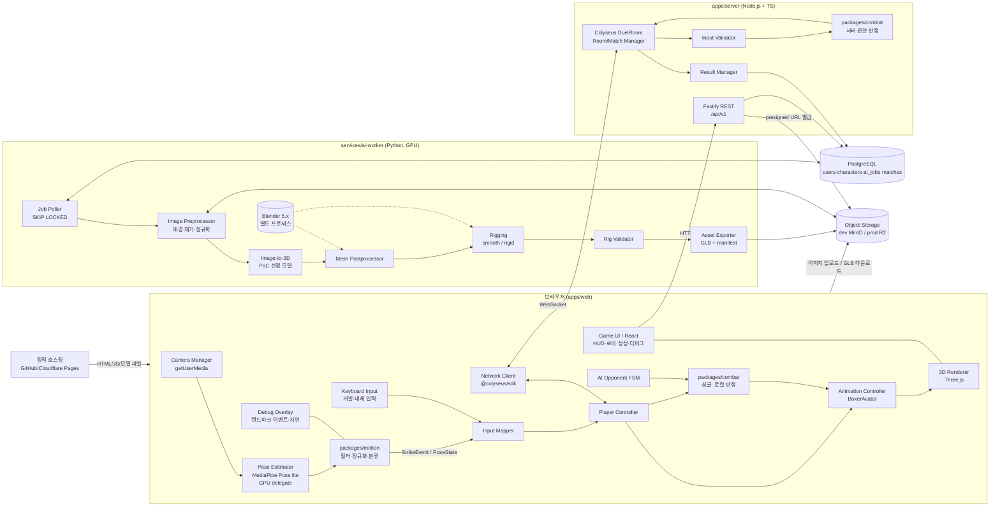
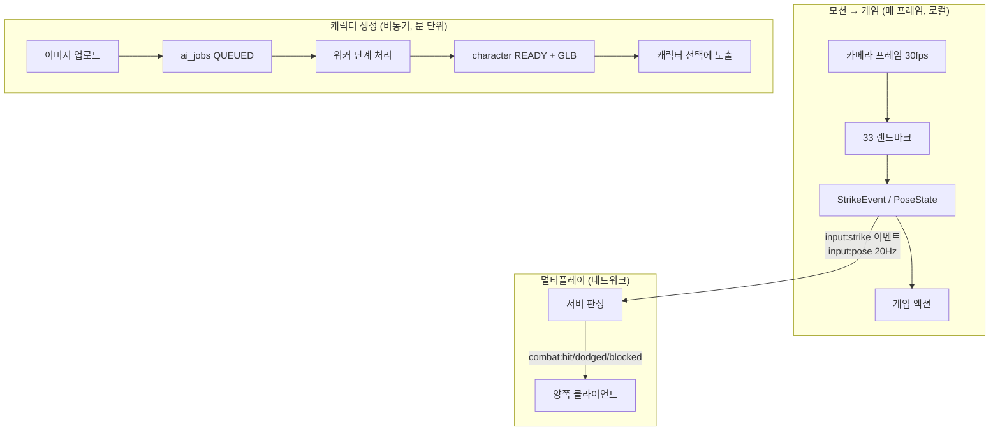
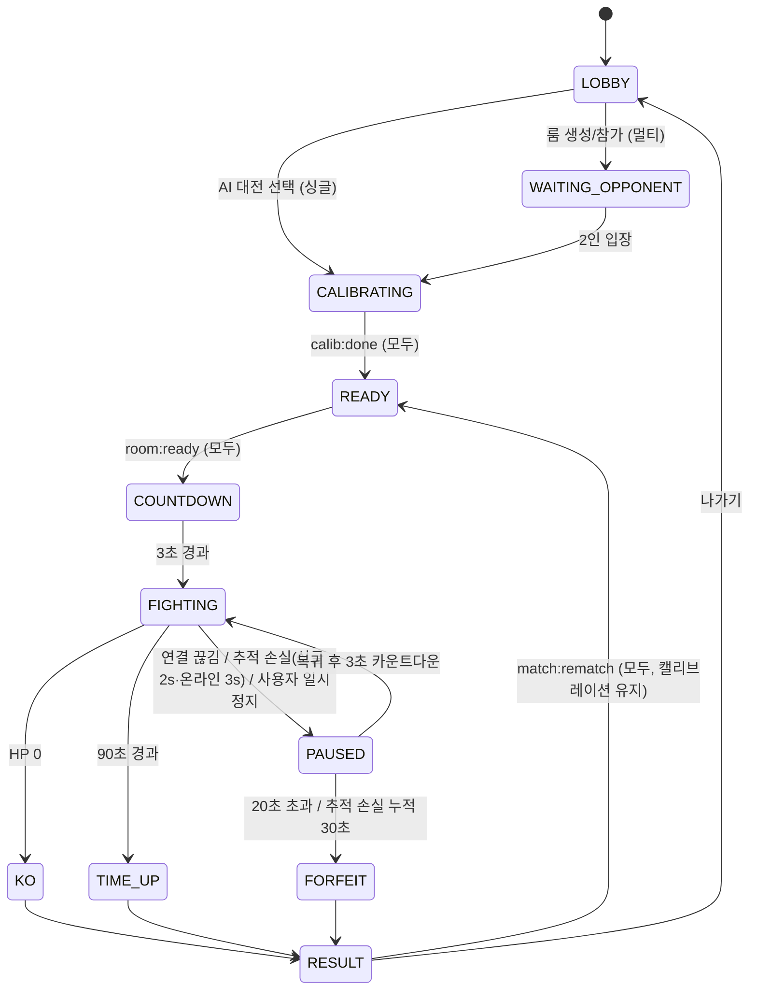

# 02. 시스템 아키텍처

> 상태: 설계. 계약(C1~C9)은 [결정 기록](designs/motion-boxing-arena.md#핵심-계약-contracts--병렬-개발-전-w1에-동결)에 정의되어 있고 이 문서는 그것을 구성요소 관점으로 풀어쓴다.

## 1. 초안 대비 단순화한 점

요구사항의 초안(Client 9개 / Game Server 6개 / AI Service 6개 / Storage 5개)은 책임 분리는 맞지만 **배포 단위가 너무 많다.** 8주·7명 팀에 맞게 다음과 같이 줄인다.

| 초안 | 변경 | 이유 |
|---|---|---|
| Game Server + 별도 REST 백엔드 | **`apps/server` 단일 Node 프로세스**(Colyseus + Fastify) | 배포·인증·DB 연결 1벌. 동접 수십 명 규모에 충분 |
| Job Queue(별도 브로커) | **Postgres 테이블 + `FOR UPDATE SKIP LOCKED`** | Redis/Celery 운영 비용 제거. 작업량 시간당 수십 건 |
| Combat System이 서버에만 존재 | **`packages/combat` 공유 순수 로직** | 싱글플레이(브라우저)·멀티(서버)가 같은 코드 → 판정 불일치 원천 차단 |
| Motion Classifier가 클라이언트 내부 | **`packages/motion` 독립 패키지** | Node에서 녹화 데이터 리플레이로 P/R/F1 자동 측정 |
| AI Service 6개 모듈 | **`services/ai-worker` 1개 Python 프로세스**, 단계는 함수 | GPU 1대에서 순차 처리 |
| Storage 5종 | **Postgres 1 + S3 호환 오브젝트 스토리지 1** | User/Character/Match/Job은 테이블, 3D 에셋은 오브젝트 |

배포 단위는 **4개**: 정적 웹(`apps/web`), 서버(`apps/server`), AI 워커(`services/ai-worker`, GPU 머신), 인프라(Postgres + 오브젝트 스토리지).

## 2. 전체 시스템 아키텍처

**경계 규칙**
- 웹캠 프레임은 `Browser` 밖으로 나가지 않는다.
- `Worker`는 서버를 호출하지 않는다. DB(작업 상태)와 오브젝트 스토리지만 만진다 → 서버와 워커는 독립 배포·장애 격리.
- `packages/combat`, `packages/motion`, `packages/shared`는 DOM·Three.js·Node API에 의존하지 않는다(순수 TS).

## 3. 구성요소 책임

### 3.1 Client (`apps/web`)

| 모듈 | 책임 | 입력 → 출력 | 담당(제안) |
|---|---|---|---|
| Camera Manager | 장치 선택, 권한, 해상도(640×480 기본), 프레임 공급 | MediaStream → HTMLVideoElement | Motion |
| Pose Estimator | `PoseLandmarker.detectForVideo`, 모델 로딩, GPU→CPU 폴백 | video frame → 33 landmarks + worldLandmarks | Motion |
| Motion Classifier | `packages/motion` 호출. 필터·캘리브레이션·FSM | landmarks → `StrikeEvent`, `PoseState` | Motion |
| Input Mapper | 웹캠/키보드/리플레이 입력을 동일 인터페이스로 | 이벤트 → `PlayerInput` | Game |
| Player Controller | 쿨다운·경직 중 입력 무시, 싱글이면 로컬 combat, 멀티면 서버 전송 | `PlayerInput` → combat 호출/네트워크 | Game |
| Animation Controller | `BoxerAvatar`(C4) 구현, 레이어 블렌딩(상체 액션 + 하체 절차적) | 액션 → 스켈레톤 포즈 | Game/3D |
| 3D Renderer | 씬, 1인칭 카메라(감쇠), 이펙트, 렌더 출력 추상화(`ViewOutput`, 홀로그램 확장 대비) | 상태 → 프레임 | Game |
| Game UI | React 화면 10종, HUD | 상태 → DOM | FE/Design |
| Network Client | 룸 접속, 시계 오프셋 추정, 보간 버퍼 | 메시지 ↔ 상태 | Server |

### 3.2 Game Server (`apps/server`)

| 모듈 | 책임 |
|---|---|
| Room Manager | `DuelRoom` 생성(6자리 코드), 최대 2인, 초대 링크 |
| Match Manager | 단계 머신(C8), 카운트다운, 타이머, 재접속(20초) |
| Input Validator | 속도 제한(초당 4펀치), seq 단조 증가, 타임스탬프 범위, 경직·쿨다운 중 입력 거부 |
| Combat System | `packages/combat`로 판정. 방어자 PoseState 링버퍼(500ms) 기반 |
| Game State | Colyseus Schema(phase, players[], timer) |
| Result Manager | 경기 통계 집계 → `matches`, `match_players` 저장 |
| REST (Fastify) | 게스트 세션, 업로드 URL, 생성 작업, 캐릭터, 결과 조회 |

### 3.3 AI Worker (`services/ai-worker`)
단계는 C9 상태와 1:1. 각 단계는 `(job, input_artifacts) → output_artifacts`인 순수 함수에 가깝게 작성하고, 산출물을 `jobs/{jobId}/{stage}/`에 저장한다. 실패 단계부터 재시도 가능. 상세: [04-AI-3D-PIPELINE](04-AI-3D-PIPELINE.md).

### 3.4 Storage
- PostgreSQL: users(게스트), characters, ai_jobs, ai_job_stages, matches, match_players, motion_recordings(동의한 경우 랜드마크만). 상세: [09-DATA-MODEL](09-DATA-MODEL.md).
- Object Storage: 업로드 원본, 단계 산출물, 최종 GLB/썸네일.

## 4. 주요 데이터 흐름 (요약)

세부 다이어그램 위치:

| 요구 다이어그램 | 위치 |
|---|---|
| 1. 전체 시스템 아키텍처 | 이 문서 §2 |
| 2. AI 2D→3D 생성 파이프라인 | [04-AI-3D-PIPELINE](04-AI-3D-PIPELINE.md) |
| 3. MediaPipe 모션 인식 데이터 흐름 | [05-MOTION-RECOGNITION](05-MOTION-RECOGNITION.md) |
| 4. 펀치 판정 시퀀스 | [06-COMBAT-SYSTEM](06-COMBAT-SYSTEM.md) |
| 5. 멀티플레이어 동기화 시퀀스 | [07-MULTIPLAYER](07-MULTIPLAYER.md) |
| 6. 게임 상태 머신 | 이 문서 §5, 파이터 상태는 [06](06-COMBAT-SYSTEM.md) |
| 7. ERD | [09-DATA-MODEL](09-DATA-MODEL.md) |

## 5. 게임(경기) 상태 머신 (C8)

싱글(AI 대전)과 멀티가 **같은 단계 머신**을 쓴다. 싱글은 브라우저 안의 `LocalMatch`가, 멀티는 서버 `DuelRoom`이 이 머신을 소유한다.

## 6. 클라이언트-서버 책임 (멀티플레이)

| 항목 | 클라이언트 | 서버 |
|---|---|---|
| 웹캠·포즈 추정·동작 분류 | ✅ 전담 | ❌ (영상·랜드마크 수신 안 함) |
| 자기 펀치 애니메이션 시작 | ✅ 즉시(예측) | — |
| 펀치 유효성(쿨다운, 경직, 속도 제한) | 1차 필터 | ✅ 최종 |
| 명중/가드/회피 판정 | ❌ | ✅ 권한 |
| HP, KO, 타이머, 승패 | 표시만 | ✅ 권한 |
| 상대 캐릭터 표시 | ✅ 100ms 보간 버퍼 | 상태 브로드캐스트 |
| 결과 저장 | — | ✅ |

## 7. 확장 포인트 (MVP에서 인터페이스만 예약)

- `ViewOutput`: `render(scene, cameraRig)`. 기본 구현 `SingleViewOutput`. 홀로그램은 다중 뷰(예: 페퍼스 고스트 4면, 라이트필드 퀼트) 구현체를 추가.
- `InputSource`: `webcam | keyboard | replay | gamepad`. 리플레이는 테스트·데모 안전망.
- `StrikeType`에 `hook`, `uppercut` 슬롯 예약. 판정 로직은 공격 방향 벡터만 추가.
- 종목 확장(태권도·펜싱): `packages/combat`의 기술 테이블과 `packages/motion`의 분류기 교체로 대응. 스켈레톤·네트워크·UI 재사용.
