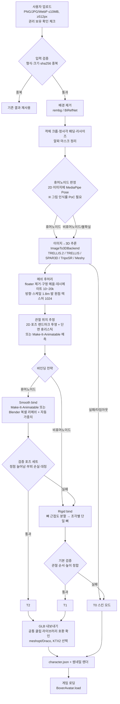

# 04. AI 2D→3D 캐릭터 생성 파이프라인

> 기준 문서: [designs/motion-boxing-arena.md](designs/motion-boxing-arena.md) (Approach B + T0/T1/T2 등급)
> 확인일 2026-10-12. "추정"과 "확인 필요"는 PoC나 원문 확인이 필요한 항목이다. 아직 구현된 것은 없다.

---

## 1. "3D 메쉬"와 "게임용 캐릭터"는 다르다

이미지→3D 모델이 출력하는 것은 **움직이지 않는 조각상**이다. 게임에 넣으려면 아래 오른쪽 열을 모두 채워야 한다.

| 항목 | 이미지→3D 모델 출력(조각상) | 게임에 필요한 캐릭터 |
|---|---|---|
| 형상 | 단일 메쉬, 떠다니는 조각·구멍·비다양체(non-manifold) 가능 | 정리된 메쉬, 10k~20k 삼각형 |
| 크기·방향 | 임의 스케일, 임의 축 | 키 1.8m 정규화, +Y up, 정면 +Z, 발이 원점 |
| 텍스처 | 고해상도 또는 정점 색 | 1024px 이하, 압축 |
| 스켈레톤 | **없음** | `mba-humanoid-v1` 22본 |
| 스킨 가중치 | **없음** | 정점별 뼈 가중치(smooth) 또는 조각별 단일 뼈(rigid) |
| 레스트 포즈 | 입력 그림의 포즈 그대로(팔을 내리거나 구부림) | A-pose(팔 45°) 정렬 |
| 애니메이션 | 없음 | 공통 클립(잽·스트레이트·가드·피격·KO·아이들) 재생 가능 |
| 충돌 영역 | 없음 | 스켈레톤 기준 정규 히트 볼륨(메쉬와 무관) |
| 메타데이터 | 없음 | `character.json` 매니페스트(출처·라이선스·등급) |

**결론:** AI 모델이 해결하는 것은 첫 두 줄의 일부다. 나머지는 알고리즘(정리·정규화), 도구(Blender), 규칙(공통 스켈레톤)이 해결한다. 이 경계를 문서와 발표에서 명확히 구분한다.

---

## 2. 전체 파이프라인



### 단계별 처리 주체

| 단계 | 처리 방식 | 학습된 AI 모델? | 실행 위치 | 예상 시간(추정) |
|---|---|---|---|---|
| 입력 검증 | 규칙 | 아니오 | API 서버 | <1초 |
| 배경 제거 | rembg(U²-Net 계열) 또는 BiRefNet | **예** | AI 워커(GPU 선호, CPU 가능) | 1~3초 |
| 크롭·정규화 | 이미지 처리 알고리즘 | 아니오 | AI 워커 | <1초 |
| 휴머노이드 판정 | MediaPipe Pose(사진에는 강하고 그림은 PoC 필요) + 마스크 종횡비 규칙 | **예** | AI 워커 | <1초 |
| 이미지→3D | 생성 모델 | **예** | GPU | 1초~2분(모델별) |
| 메쉬 후처리 | trimesh/pymeshlab/Blender 알고리즘 | 아니오 | AI 워커 CPU | 5~20초 |
| 관절 추정 | 휴리스틱(기본) 또는 Make-It-Animatable(학습 모델) | 선택 | AI 워커 | 5~30초 |
| 바인딩 | Blender 자동 가중치(bone heat, 알고리즘) / 학습 기반 가중치 / rigid 분할(알고리즘) | 선택 | Blender 별도 프로세스 | 5~30초 |
| 검증 | 기하 측정 알고리즘 | 아니오 | Blender/trimesh | 2~5초 |
| 내보내기·썸네일 | Blender | 아니오 | Blender | 3~10초 |

---

## 3. 핵심 질문 A~J

### A. 이미지 한 장으로 충분한가?
- **게임 캐릭터 용도로는 충분하다.** 단 조건이 있다. 1인칭 화면에서 상대는 주로 정면과 상반신으로 보인다. 그래서 보이지 않는 후면은 모델이 상상해서 채워도 체감 품질 손실이 작다.
- 품질에 가장 큰 영향을 주는 것은 장 수보다 **입력 그림의 포즈**다. 정면, 전신, 팔과 몸통이 떨어진 A/T 포즈가 필요하다. 팔이 몸에 붙어 있으면 메쉬에서 팔과 몸통이 붙어 생성되고, 리깅이 실패하는 1순위 원인이 된다(추정, PoC P3에서 측정).
- **대응:** 업로드 화면에 "좋은 그림 / 나쁜 그림" 예시를 둔다. 브라우저 내 **실루엣 템플릿 드로잉 캔버스**도 제공한다. A-pose 윤곽선 위에 직접 그리게 해서 입력 분포를 파이프라인이 잘 처리하는 쪽으로 유도한다.

### B. 여러 장(정면·측면·후면)의 실제 이점
| 이점 | 실제 효과 |
|---|---|
| 후면·측면 형상 정확도 | 보통~큼. 하지만 1인칭 게임에서는 잘 보이지 않는 부분이다 |
| 텍스처 일관성(뒷면 색) | 보통 |
| 두께 추정(납작함 감소) | 큼. 만화 캐릭터가 종잇장처럼 되는 문제 완화 |
| 리깅 성공률 | 작음(포즈 영향이 더 큼, 추정) |

- 비용: 사용자가 같은 캐릭터를 일관되게 세 장 그려야 한다. 일반 사용자에게 이 부담은 크다.
- TRELLIS 계열의 다중 이미지 조건 입력 지원 여부는 **확인 필요**다. 지원하더라도 MVP에서는 **단일 이미지**만 쓰고, 다중 이미지는 확장 단계의 선택 입력으로 둔다.

### C. 이미지 기반 3D 모델에 관절을 자동으로 추가할 수 있는가?
**가능하다. 다만 "학습 기반 자동 리거"와 "템플릿 맞춤"을 구분해야 한다.**

| 방법 | 원리 | 장점 | 단점 | 라이선스 |
|---|---|---|---|---|
| 템플릿 맞춤(기본 경로) | 공통 스켈레톤 관절을 메쉬에 배치한다. 위치는 2D 포즈 랜드마크를 메쉬 정면에 투영하고, 높이별 단면 폭(어깨·골반 위치) 휴리스틱으로 보정한다 | 출력 스켈레톤이 항상 `mba-humanoid-v1` | 그림이 비정형이면 관절이 어긋남 | 자체 구현 |
| Make-It-Animatable (CVPR 2025) | 휴머노이드 관절·가중치 예측. Mixamo 스켈레톤으로 학습 | Mixamo 계열 → 공통 스켈레톤 매핑이 쉬움(추정) | 출력 형식·정확한 관절 구성 확인 필요 | MIT |
| UniRig (VAST) | 범용 스켈레톤·스킨 예측(사람·동물·사물) | 비인간형 지원 | 출력 스켈레톤이 공통 규격이 아님 → 매핑 필요. CUDA 8GB 이상 | MIT |
| Puppeteer (Seed3D) | 범용 스켈레톤 | 가중치 공개 | Mixamo 명명 아님. 내보내기에 bpy 4.2 필요 | Apache-2.0 |
| Blender 자동 가중치(bone heat) | 관절 배치 후 열 확산으로 가중치 계산 | 학습 불필요, 결정적 | **비다양체 메쉬에서 자주 실패** → 복셀 리메쉬로 사전 정리 필요 | GPL(별도 프로세스) |
| Mixamo 오토리거 | 웹 UI에서 수동 마커 배치 | 품질 좋음 | **공식 API 없음(확인 필요)** → 자동화 불가. 시연 갤러리 캐릭터를 팀원이 수동 제작하는 데만 사용 | Adobe 약관 |

**PoC P3에서 템플릿 맞춤 + Blender 가중치와 Make-It-Animatable을 같은 20개 메쉬로 비교해 기본 경로를 정한다.** UniRig·Puppeteer는 비교 실험군으로만 둔다(공통 스켈레톤 매핑 비용 때문).

### D. 사람·로봇·만화 캐릭터에 같은 리깅 파이프라인을 적용할 수 있는가?
같은 **파이프라인**은 쓰지만 같은 **바인딩 전략**은 쓰지 않는다.

| 유형 | 특징 | 바인딩 | 예상 등급 |
|---|---|---|---|
| 사람형(사실적) | 관절 위치 명확 | smooth | T2 |
| 만화(2~3등신, 큰 머리) | 머리가 몸통의 절반, 팔이 짧음 | smooth 시도 → 머리 정점이 목 회전에 끌려가면 rigid 강등 | T2 또는 T1 |
| 로봇 | 단단한 부품, 관절 이음새 | **rigid가 오히려 자연스러움**(부품이 휘지 않음) | T1 |
| 비휴머노이드(동물·사물) | 팔·다리 대응 불명확 | rigid(가능한 부분만) → 실패 시 T0 | T1 또는 T0 |

등급은 사용자에게 숨기지 않는다. 미리보기 화면에 "부드러운 관절 / 액션 피규어 관절 / 스킨 모드" 배지를 보여준다.

### E. 체형이 다른 캐릭터에 같은 복싱 동작을 적용하는 방법
1. **공통 스켈레톤 + 로컬 회전 애니메이션:** 클립은 각 뼈의 로컬 회전만 담는다. 팔 길이가 달라도 같은 회전을 적용하면 같은 "모양"의 펀치가 된다. 루트 이동만 키 비율로 스케일한다.
2. **게임플레이는 체형과 무관:** 히트 볼륨은 정규값(머리 구 r=0.13m, 몸통 캡슐 r=0.18m·h=0.5m, 글러브 r=0.08m)을 스켈레톤 관절 위치에 붙인다. 하지만 **판정 계산은 정규 체형 기준 좌표**로 한다. 팔이 긴 캐릭터가 사거리 이득을 보지 않는다.
3. **시각 보정(선택, MVP 4):** 팔이 아주 짧은 만화 캐릭터는 펀치가 상대에게 닿아 보이지 않는다. 그래서 active 구간에만 2-bone IK로 글러브를 정규 타격 지점 쪽으로 최대 15cm 당긴다.
4. **레스트 포즈 차이:** 생성 메쉬의 원래 포즈(팔 내림 등)는 리깅 단계에서 A-pose로 재포즈한다(관절 회전 적용 후 메쉬에 굽기). 클립과 레스트 포즈를 일치시킨다.

### F. 관절 변형이 비정상일 때 복구 방법
**검증 포즈 세트**(잽 최대 신전, 스트레이트, 가드, 슬립 좌/우, 피격 젖힘)를 적용하고 다음을 측정한다.

| 지표 | 계산 | 기준(초기값, PoC로 조정) |
|---|---|---|
| 최대 엣지 늘어남 비율 | 포즈 후 엣지 길이 / 레스트 엣지 길이 | p99 ≤ 2.0 |
| 팔꿈치·어깨 부피 손실 | 관절 주변 국소 볼록 껍질 부피 비 | ≥ 0.6 |
| 머리 정점 끌림 | 머리 영역 정점 중 Head 외 뼈 가중치 > 0.3 비율 | ≤ 5% |
| 좌우 대칭 | 좌우 관절 높이 차 / 키 | ≤ 3% |

복구 순서(자동):
1. 가중치 스무딩 + 머리 영역 Head 뼈 고정 후 재검증
2. 복셀 리메쉬 해상도를 바꿔 재바인딩
3. **rigid bind로 강등(T1)**: 실패하지 않는 경로
4. T1 기본 검증도 실패하면 T0

사용자에게는 "관절 품질이 낮아 액션 피규어 모드로 만들었어요" 같은 설명과 함께 "다른 그림으로 다시 시도" 버튼을 제공한다.

### G. 생성이 오래 걸릴 때 비동기 작업 큐
- **큐:** PostgreSQL `ai_jobs` 테이블. 워커는 다음 쿼리로 작업을 가져간다. Redis·Celery는 쓰지 않는다.
  ```sql
  UPDATE ai_jobs SET status = 'PREPROCESSING', worker_id = $1, started_at = now(), heartbeat_at = now()
  WHERE id = (SELECT id FROM ai_jobs WHERE status = 'QUEUED' ORDER BY priority DESC, created_at
              FOR UPDATE SKIP LOCKED LIMIT 1)
  RETURNING *;
  ```
- **상태 머신(C9):** `QUEUED → PREPROCESSING → GENERATING → POSTPROCESSING → RIGGING → VALIDATING → EXPORTING → READY` / `FAILED{stage, retryable, reason}`
- **단계 산출물 보존:** `jobs/{jobId}/{stage}/...`로 스토리지에 저장한다. 재시도는 `FAILED.stage`부터 직전 단계 산출물을 입력으로 재개한다. GPU 단계(GENERATING)를 다시 돌리지 않고 리깅만 재시도할 수 있다.
- **하트비트:** 워커가 10초마다 `heartbeat_at`을 갱신한다. 60초 이상 갱신이 없으면 리퍼가 `QUEUED`로 되돌린다(최대 시도 3회).
- **클라이언트 진행 표시:** `GET /api/jobs/:id` 폴링(2초) 또는 SSE. 단계명과 예상 남은 시간(최근 20건의 단계별 p50 기반)을 보여준다.
- **T0 우선 생성:** 업로드 직후 클라이언트가 T0 스킨을 항상 먼저 만든다(2초 이내). T1/T2는 백그라운드에서 생성되고, 완료되면 다음 경기의 READY 진입 시점에 자동 교체한다(결정 기록 C13).
- **타임아웃:** PREPROCESSING 30s, GENERATING 5min, POSTPROCESSING 2min, RIGGING 2min, VALIDATING 1min, EXPORTING 1min, 전체 10min. 초과하면 FAILED(retryable)가 되고 T0가 유지된다.
- **정렬·휴머노이드 판정:** 생성 메쉬 정면 렌더와 원본 이미지에 MediaPipe Pose를 실행해 관절을 피팅한다. 핵심 랜드마크 17개 중 13개 이상 visibility ≥ 0.5여야 T2/T1 후보가 되고, 정렬에 실패하면 rigid 바인딩도 하지 않고 T0로 간다(C14).
- **사용자 경험:** 생성 중에도 다른 화면(AI 대전)으로 이동할 수 있다. 완료되면 토스트 알림. 설계 문서의 "경기 중 생성 완료" 시연 트릭이 이 구조에 기댄다.

### H. GPU 사용량과 비용 관리
| 수단 | 내용 |
|---|---|
| 온디맨드 GPU | RunPod 등에서 시연·테스트 기간에만 Pod 실행. 상시 GPU를 두지 않는다 |
| 사용자 할당량 | 게스트 1인당 하루 3회, 전체 하루 상한(예: 100회). 초과 시 T0만 제공 |
| 중복 제거 | 전처리 후 이미지 sha256 + 파이프라인 버전이 같으면 기존 결과 재사용 |
| 시연 갤러리 사전 생성 | 시연에 쓸 캐릭터 10~20개를 미리 생성·검수해 고정. **시연이 라이브 GPU에 의존하지 않음** |
| 배치 처리 | 대기열이 쌓이면 모델을 한 번 로드한 상태로 연속 처리(콜드 스타트 상쇄) |
| 모델 상주 | 워커 프로세스가 모델을 메모리에 유지. 요청마다 로드하지 않음 |
| 해상도 단계 | 미리보기용 저해상도(빠른 설정)를 먼저 생성하고 사용자가 확정하면 고품질로 생성(확장) |

**비용 추정(RunPod, 2026-10-12 확인 시점 가격, 변동 가능):**

| GPU | Community | Secure | 비고 |
|---|---|---|---|
| RTX 4090 (24GB) | $0.34/h | $0.74/h | 페이지 표에는 $0.89/h 표기도 있음 → 콘솔에서 재확인 |
| L4 (24GB) | $0.44/h | $0.49/h | |
| A40 (48GB) | $0.35/h | $0.49/h | |
| A100 80GB | $1.19~1.39/h | $1.59/h | 표 표기 $1.79/h |

출처: https://www.runpod.io/pricing

- 가정(추정): 1건당 GPU 점유 약 1분, 4090 $0.74/h → 건당 약 $0.012. 개발·테스트 300건 + 대기·콜드 스타트 오버헤드 3배를 잡아도 **약 $10~20 수준**(추정).
- 실제 비용을 지배하는 것은 생성 시간보다 **켜두고 잊은 Pod**다. 자동 종료 스크립트(유휴 15분 후 stop)를 넣고 팀 채널에 비용 알림을 둔다.
- Meshy API: Image-to-3D 메쉬만 20 크레딧, 텍스처 포함 30 크레딧, 오토리깅 5 크레딧, 애니메이션 동작당 3 크레딧. 크레딧의 달러 단가는 구독 플랜 기준이라 **확인 필요**. 출처: https://docs.meshy.ai/en/api/pricing

### I. 생성 실패 시 대체 경로
| 실패 지점 | 사용자에게 제시하는 대체 경로 |
|---|---|
| 업로드 검증 실패 | 원인 표시(크기·형식) + 예시 그림 |
| 배경 제거 품질 낮음(마스크 면적 <5% 또는 >95%) | "배경이 단순한 그림으로 다시 시도" + 템플릿 캔버스 |
| 이미지→3D 실패·타임아웃 | ① 다른 시드로 재시도 ② **T0 스킨 모드 즉시 생성** |
| smooth 리깅 검증 실패 | 자동 T1 강등(사용자 개입 없음) |
| T1도 실패 | T0 + "다른 그림으로 다시 시도" |
| GPU 워커 다운 | 업로드는 받아 두고 "생성 대기 중" 상태 유지 + T0 즉시 사용 가능 |
| 할당량 초과 | T0 + 내일 다시 시도 안내 |

**T0 스킨 모드(항상 성공):** 클라이언트에서 업로드 이미지의 k-means 팔레트(5색)를 추출해 기본 복서의 트렁크·글러브·피부 톤 슬롯에 매핑한다. 배경 제거 이미지(서버 단계가 실패하면 원본 중앙 크롭)를 가슴 데칼 또는 얼굴판에 투영한다. 2초 내 완료가 목표이고 GPU를 쓰지 않는다.

### J. 업로드 이미지와 생성 모델의 소유권·저작권·라이선스
- **업로드 시 권리 확인:** "이 이미지를 사용할 권리가 있습니다(직접 그림 또는 허락받음)" 체크박스가 필수다. 기록 필드는 `license.userAttestedRights`와 시각이다.
- **기본 비공개:** 생성 캐릭터는 `visibility: private`가 기본이다. 온라인 대전 상대에게는 GLB가 전달되므로 "대전 시 상대에게 표시됨"을 명시한다. 공개 갤러리는 확장 기능이다.
- **출처 기록(provenance):** 매니페스트에 `model`, `modelVersion`, `seed`, `rigger`, `pipelineVersion`, `createdAt`을 기록한다. 어떤 모델 라이선스 아래에서 만들어졌는지 추적할 수 있다.
- **모델 라이선스 준수:**
  - **Hunyuan3D 사용 금지.** Tencent Hunyuan 3D Community License(2.1) 1.l항이 Territory를 "the worldwide territory, excluding the territory of the European Union, United Kingdom and South Korea"로 정의하고, 5(c)항은 Territory 밖 사용을 라이선스 없음으로 규정한다. 호스팅된 Space를 호출하는 것도 마찬가지다. 출처: https://huggingface.co/tencent/Hunyuan3D-2.1/blob/main/LICENSE
  - SPAR3D/SF3D: Stability AI Community License. 연매출 100만 달러 미만 무료. 학교 프로젝트는 해당 없음.
  - TRELLIS 계열: MIT. 단 nvdiffrast 등 NVIDIA 의존성 라이선스는 **확인 필요**(비상업 조건 가능성).
- **IP 캐릭터:** 유명 캐릭터 업로드를 기술적으로 막을 수는 없다. 비공개 기본, 신고·삭제(takedown) 절차, "타인의 저작물 업로드 금지" 약관 문구로 대응한다.
- **삭제권:** 사용자가 캐릭터를 삭제하면 원본 이미지, 단계 산출물, GLB를 모두 스토리지에서 삭제한다(soft delete 후 24시간 내 하드 삭제).
- **학습 사용 금지:** 사용자 업로드 이미지는 모델 학습·평가 데이터셋에 쓰지 않는다. 평가셋은 팀이 직접 그리거나 라이선스가 명확한 이미지로 구성한다.

---

## 4. 방식 A vs 방식 B 비교

| 기준 | 방식 A: 완전 새 캐릭터 + 자동 리깅 | 방식 B: 공통 스켈레톤 + AI 외형 |
|---|---|---|
| 자유도 | 최고(문어·뱀도 가능) | 휴머노이드 중심, 비인간형은 rigid로 제한 |
| 애니메이션 재사용 | 캐릭터별 리타겟 필요, 품질 편차 큼 | **모든 캐릭터가 같은 클립 공유** |
| 판정 공정성 | 캐릭터마다 히트박스가 다름 | 정규 히트 볼륨으로 동일 |
| 네트워크 동기화 | 스켈레톤 메타 전송 필요 | 행동 이벤트만 전송 |
| 시각 품질 | 성공하면 높고 실패하면 매우 나쁨 | 중상(smooth) ~ 중(rigid). 편차 작음 |
| 구현 난이도 | 매우 높음 | 중상 |
| 8주 성공 가능성 | 낮음(추정 30% 이하) | 중상(추정 70% 이상, T0 포함 시 100%) |
| 생성 비용 | 리깅 모델 추가 GPU 사용 | 생성 GPU + CPU 리깅 |
| 실패 처리 | 실패하면 캐릭터 없음 | T2→T1→T0 단계 강등 |

**추천: 방식 B (T0/T1/T2 등급).** 방식 A는 확장 단계 연구 과제로 남긴다(UniRig 기반 비휴머노이드 실험).

---

## 5. 이미지→3D 모델 후보 비교

| 모델 | 라이선스 | 최소 VRAM | 속도 | 출력 | 리깅 | 판정 |
|---|---|---|---|---|---|---|
| **TRELLIS.2** (Microsoft) | MIT(모델·코드). nvdiffrast/nvdiffrec는 NVlabs 별도 라이선스(**확인 필요**), FlexGEMM·CuMesh·O-Voxel 라이선스 미기재 | **24GB**(A100/H100에서 테스트) | H100 기준 512³ 약 3초, 1024³ 약 17초, 1536³ 약 60초 | PBR GLB | 없음 | 품질 1순위. 24GB GPU 필요 |
| TRELLIS (v1) | MIT(추정, 확인 필요) | 약 16GB(추정) | 확인 필요 | GLB / 3D Gaussians | 없음 | 16GB GPU일 때 |
| SPAR3D / SF3D (Stability) | Stability AI Community License(연매출 100만 달러 미만 무료) | 명시 없음 | 1초 미만 | UV 펼친 텍스처 메쉬 + roughness/metallic | 없음 | 속도 1순위 |
| TripoSR | MIT(추정, 확인 필요) | 약 6GB(추정) | 1초 미만 | 정점 색 메쉬 | 없음 | 저사양 베이스라인, 품질 낮음(추정) |
| Meshy API | 상용 약관(확인 필요) | 불필요 | 확인 필요 | 텍스처 메쉬, **API로 리깅·애니메이션 가능** | 있음(5 크레딧) | GPU 확보 실패 시 대체 백엔드 |
| ~~Hunyuan3D 2.1~~ | Tencent Hunyuan 3D Community License | 형상 약 10GB, 텍스처 약 21GB | — | PBR 메쉬 | 없음 | **제외: 대한민국은 라이선스 적용 지역 밖** |

출처: https://github.com/microsoft/TRELLIS.2 , https://huggingface.co/stabilityai/stable-point-aware-3d , https://github.com/Tencent-Hunyuan/Hunyuan3D-2.1 , https://docs.meshy.ai/en/api/pricing

워커 백엔드 인터페이스:
```python
class ImageTo3DBackend(Protocol):
    name: str; version: str
    def load(self) -> None: ...
    def generate(self, rgba_image: Path, seed: int, out_dir: Path) -> GenerationResult: ...  # raw GLB/OBJ + timings
```

---

## 6. PoC 계획 (W1~W2)

### 테스트 이미지 세트 (20장, 팀 제작 또는 라이선스 명확)
| 유형 | 장수 | 예 |
|---|---|---|
| 사람형 사진풍 A-pose | 4 | 팀원 일러스트 |
| 사람형 손그림(종이 스캔) | 4 | 연필·마커 |
| 만화 2~3등신 | 4 | 큰 머리 |
| 로봇 | 4 | 각진 부품 |
| 어려운 케이스 | 4 | 팔 붙임, 측면 포즈, 복잡한 배경, 동물 |

### P2: 이미지→3D 모델 벤치마크
- 대상: TRELLIS.2(24GB GPU가 있을 때) 또는 TRELLIS v1, SPAR3D, TripoSR. 선택적으로 Meshy 5장.
- 측정: 성공률(유효 메쉬 생성), 생성 시간 p50/p95, 피크 VRAM, 삼각형 수, 정면 실루엣 IoU(입력 마스크 대비), 팀원 5명의 1~5점 외형 평가(블라인드).
- **Go 기준:** 사람형·만화형 12장 중 외형 평균 3.5점 이상인 모델이 하나 이상 있고, p95 생성 시간 ≤ 2분.
- **No-Go 시:** Meshy API를 기본 백엔드로 전환. 그것도 불가하면 MVP 3 범위를 T0 + 팀 수동 제작 갤러리로 축소.

### P3: 리깅 벤치마크
- 입력: P2 최고 모델의 20개 메쉬.
- 비교: (a) 템플릿 맞춤 + Blender 자동 가중치(복셀 리메쉬 후) (b) Make-It-Animatable (c) rigid bind.
- 측정: 검증 포즈 지표(3.F), 처리 시간, T2/T1/T0 분포, 팀원 육안 평가(잽 애니메이션 재생 영상).
- **Go 기준:** 20장 중 T1 이상 ≥ 14장(70%), 사람형·만화형 8장 중 T2 ≥ 4장.
- **No-Go 시:** rigid만 사용(T1 상한). 관절 품질 개선은 MVP 4 과제로 넘긴다.

### 산출물
- `tools/datasets/char-eval-v1/` 이미지 + 결과 GLB + 지표 CSV
- `docs/reports/poc-p2-p3.md`(W2 말 Go/No-Go 결정 기록)
