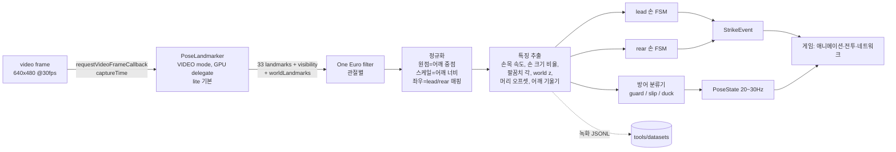
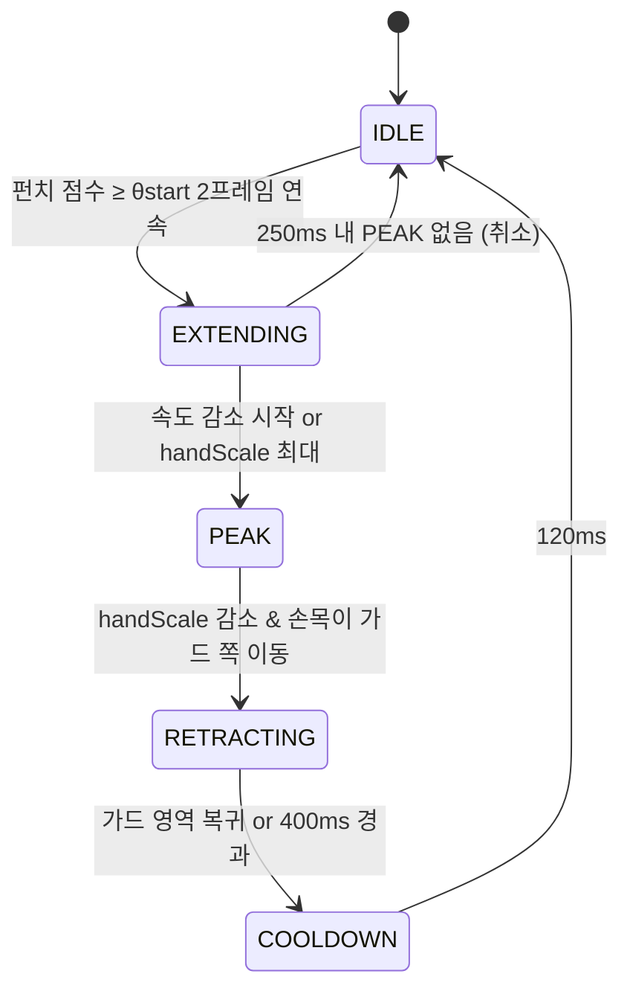

# 05. 모션 인식 설계 (MediaPipe → 행동 이벤트)

> 기준 문서: [designs/motion-boxing-arena.md](designs/motion-boxing-arena.md) Premise 2, 6, 7 / 계약 C2.
> 구현 전 설계다. 수치 중 "추정"과 "PoC 필요" 표시는 W1 PoC(P1)에서 확인한다.

## 1. 역할과 경계

- 모션 인식의 출력은 **행동 이벤트(`StrikeEvent`)와 저차원 상태(`PoseState`)** 뿐이다(C2).
- 게임 캐릭터의 팔 궤적, 타격 여부, 데미지는 모션 인식이 결정하지 않는다([06-COMBAT-SYSTEM.md](06-COMBAT-SYSTEM.md)).
- 실제 힘·거리·속도(m/s)를 측정한다고 가정하지 않는다. 모든 임계값은 **사용자별 캘리브레이션 대비 상대값**이다.
- 학습된 모델: Pose Landmarker(사전 학습, 그대로 사용). 그 뒤 단계는 모두 일반 알고리즘(필터·특징·상태 머신)이다.

## 2. 데이터 흐름



- 실행 위치: `packages/motion`(순수 TS)은 랜드마크 배열만 입력받는다. MediaPipe 호출은 `apps/web`의 `PoseEstimator`가 담당한다. 따라서 분류기는 **Node에서 녹화 파일 리플레이로 테스트**할 수 있다.
- 추론은 메인 스레드에서 `detectForVideo`를 호출한다. 렌더 프레임과 분리하기 위해 `requestVideoFrameCallback`으로 새 카메라 프레임에만 추론한다. Web Worker + OffscreenCanvas 이전은 성능 문제가 측정될 때만 진행한다(PoC 필요).

## 3. 사용 랜드마크 (Pose Landmarker 33점 중)

| 부위 | 인덱스 | 용도 |
|---|---|---|
| 코 | 0 | 머리 위치(회피·숙이기) |
| 귀 | 7 / 8 | 머리 위치 보조, 머리 회전 추정 |
| 어깨 | 11 / 12 | 원점·스케일·어깨선 기울기 |
| 팔꿈치 | 13 / 14 | 팔꿈치 각 |
| 손목 | 15 / 16 | 펀치 속도·위치 |
| 새끼손가락 | 17 / 18 | 손 겉보기 크기 |
| 검지 | 19 / 20 | 손 겉보기 크기, 손끝 방향 |
| 엄지 | 21 / 22 | 손 겉보기 크기 보조 |
| 엉덩이 | 23 / 24 | 보이면 상체 중심 보조(대부분 상반신만 보이므로 선택) |

## 4. 캘리브레이션

| 단계 | 시간/횟수 | 측정값 |
|---|---|---|
| 기본 자세(중립) | 3초 정지 | 머리 중립 위치 `head0`(카메라 프레임, 어깨 너비 단위), 어깨 너비 `sw0`, 손 크기 `hand0`(손별), 노이즈 표준편차 |
| 가드 | 2초 | 가드 시 손목-코 거리 `gDist`, 손목 높이 |
| 잽(lead) | 3회 | 손목 최고 속도 `vPeakLead`, 손 크기 최대 비율 `sPeakLead`, 팔꿈치 최대 각 |
| 스트레이트(rear) | 3회 | `vPeakRear`, `sPeakRear` |
| 좌/우 회피 | 각 3회 | 최대 머리 X 오프셋 `slipL`, `slipR` |
| (확장) 숙이기 | 3회 | 최대 머리 Y 하강 `duckY` |

- 각 동작의 임계값 = 측정 최대값 × 비율 k(초기 0.5, 설정에서 민감도로 조정). 3회 중 2회 이상 검출되지 않으면 해당 동작 k를 0.4로 완화하고 재시도한다.
- 결과는 `CalibrationProfile`로 localStorage에 저장한다(try/catch). 서버로 보내지 않는다.

## 5. 좌우 정규화와 손 매핑

- 웹캠 미리보기는 거울(미러) 표시하지만, **분류기는 미러 전 원본 좌표 기준**으로 동작한다.
- MediaPipe 포즈 랜드마크의 left/right는 "피사체 기준"으로 알려져 있으나 미러 여부와 결합 시 혼동이 잦다 → **PoC에서 실제 왼손을 들어 인덱스 15/16 중 어느 것이 움직이는지 확인 후 상수로 고정**(PoC 필요).
- 손 역할 매핑: 오소독스(기본) `lead = 왼손`, `rear = 오른손`. 사우스포 설정 시 반전. 게임에는 손 좌우가 아니라 `lead/rear`로 전달한다(C2).

## 6. 특징 추출

모든 위치는 정규화 좌표(원점 어깨 중점, 단위 어깨 너비)다. 프레임 간 시간은 `captureTime` 차이로 계산한다(고정 33ms 가정 금지).

| 특징 | 계산 | 의미 |
|---|---|---|
| `wristSpeed` | 정규화 손목 2D 속도(단위/s) | 펀치 동작의 폭발적 움직임 |
| `handScale` | 손목-검지-새끼 삼각형 둘레 / `hand0` | **카메라 쪽으로 다가오는 정도(깊이 대리값)** |
| `elbowAngle` | 어깨-팔꿈치-손목 각(worldLandmarks 사용) | 팔 펴짐 |
| `wristZ` | worldLandmarks 손목 z − 어깨 z | 깊이 방향(노이즈 큼, 보조) |
| `wristToCenter` | 손목과 얼굴 중심선 사이 X 거리 | 스트레이트 계열은 중심선으로 모임 |
| `headOffset` | (코 위치 − `head0`) / `sw0` (카메라 프레임 기준) | 회피·숙이기 |
| `shoulderTilt` | 어깨선 각도 − 중립 각도 | 몸통 기울임 |
| `guardScore` | 양 손목이 코 주변 영역(`gDist` × 1.3 이내) + 어깨 위 | 가드 |

## 7. 펀치 판별: 손별 상태 머신



펀치 점수(손별, 0~1):

```
s = 0.4 · clamp(wristSpeed / (k · vPeak))
  + 0.35 · clamp((handScale − 1) / (k · (sPeak − 1)))
  + 0.15 · clamp((elbowAngle − angleGuard) / (angleMax − angleGuard))
  + 0.10 · clamp(−wristZ 변화량 / 기준)
θstart = 0.6
```

- **이벤트 발행 시점은 EXTENDING 진입 시점**이다(PEAK까지 기다리지 않음 → 지연 감소). 이벤트 `confidence`는 진입 프레임의 점수와 관련 관절 visibility 최소값의 곱.
- 잽/스트레이트 구분: MVP는 손으로 구분(`lead → jab`, `rear → straight`). 훅(측면 궤적, 팔꿈치 각 90° 유지, 손목 X 큰 이동)과 어퍼컷(손목 Y 상승)은 확장 단계에서 궤적 특징으로 추가한다.
- 가중치·θstart는 초기값이며 v2 단계에서 녹화 데이터로 튜닝한다.

### 중복 펀치 방지
- 손별로 EXTENDING 진입은 IDLE에서만 가능 → 한 번의 팔 뻗기에 이벤트 1개.
- COOLDOWN 120ms + 게임 측 손별 쿨다운(C6 recovery) 이중 방지.
- 양손 동시 EXTENDING(몸 전체가 흔들린 경우 오인식 의심): 어깨 중점 속도가 크면 둘 다 억제.

## 8. 방어 분류

| 상태 | 조건(초기값) | 비고 |
|---|---|---|
| `guard` | `guardScore` ≥ 0.7 이 150ms 유지 | `PoseState.guard`는 0~1 연속값으로도 전달 |
| `slip_left` / `slip_right` | `headOffset.x` ≤ −k·`slipL` / ≥ k·`slipR` | 방향은 사용자 기준 좌우로 정규화 |
| `duck` (확장) | `headOffset.y` ≤ −k·`duckY` 이고 어깨 중점도 하강 | 앉았다 일어서기와 구분 필요(PoC) |
| `none` | 그 외 | |

- 히스테리시스: 진입 임계 k, 해제 임계 0.6k로 깜빡임을 막는다.
- `PoseState.headX/headY`는 이벤트가 아니라 연속값으로 20~30Hz 전송한다. 회피 성공은 게임이 이 연속값으로 판정한다([06](06-COMBAT-SYSTEM.md)).

## 9. 단일 RGB 웹캠의 한계와 대응

### 9.1 깊이 추정 한계
- 카메라 정면으로 뻗는 펀치는 2D에서 팔이 **오히려 짧아 보인다**(원근 단축). 2D 팔 길이만으로는 잽을 놓친다.
- 대응: (1) 손 겉보기 크기 증가(`handScale`)를 주 깊이 단서로 사용 (2) worldLandmarks z는 노이즈가 크므로 보조 가중치만 (3) 손목 속도 폭발을 함께 사용 (4) 사용자에게 약간 비스듬한 복싱 스탠스를 안내해 측면 성분을 확보.
- `handScale`이 실제로 안정적인지는 **PoC 필요**(손 랜드마크 17~22는 손목보다 visibility가 낮을 수 있음).

### 9.2 손이 얼굴을 가리는 문제
- 가드 자세에서 손이 코·귀를 가려 머리 랜드마크 visibility가 떨어진다.
- 대응: 머리 위치는 코·양귀 중 visibility 높은 점의 가중 평균. 모두 낮으면 **직전 값 유지 + 어깨 중점 이동량으로 보정**. 이 구간에서 가드 판정은 "손목이 얼굴 영역에 있고 머리 visibility 하락"을 오히려 가드 증거로 사용.

### 9.3 몸통 회전 vs 실제 머리 이동
- 펀치를 던질 때 몸통이 회전하면 코가 옆으로 이동해 회피로 오인될 수 있다.
- 대응: (1) 펀치 FSM이 EXTENDING/PEAK인 동안 slip 진입 임계를 1.5배로 상향 (2) 어깨선 기울기(`shoulderTilt`)와 머리 이동 방향이 일치할 때 slip 신뢰도 가산 (3) 머리 오프셋은 **어깨 기준이 아니라 카메라 프레임 기준**(실제 슬립은 상체 전체가 이동하므로).
- 사용자가 서서히 옆으로 이동하는 것은 회피가 아니다 → `head0`를 시간상수 5초의 느린 저역통과로 추적(드리프트 보정). 단, slip 상태 동안에는 갱신 중지.

## 10. 노이즈 필터링과 신뢰도

- 관절별 **One Euro 필터**(minCutoff 1.0, beta 0.02 초기값). 속도 기반 컷오프라 정지 시 떨림 감소, 빠른 펀치는 지연이 적다. 속도 특징은 필터 전 원본과 필터 후 값을 비교해 PoC에서 선택.
- visibility < 0.5인 관절은 해당 프레임 특징 계산에서 제외. 펀치 판정에 필요한 관절(어깨·팔꿈치·손목)이 제외되면 그 손의 FSM은 상태 유지(새 이벤트 발행 안 함).
- 추적 손실(어깨 visibility < 0.5 또는 미검출 500ms 이상) → 펀치 이벤트 중지. **판정용 PoseState는 `headX=0, headY=0, guard=0`으로 전송**한다(화면 이탈을 회피로 인정하지 않음). 마지막 머리 값은 카메라 연출에만 쓴다. 손실 2초(싱글) / 3초(온라인)가 지나면 `trackingLost` → 자동 일시정지.
- 이벤트 `confidence < 0.4`는 발행하되 게임이 무시하고 디버그 로그에만 회색으로 표시(오인식 분석용).

## 11. 지연 예산

| 구간 | 예상 | 근거 |
|---|---|---|
| 카메라 노출·전달 | 33ms (30fps 한 프레임) + 장치 지연 | 웹캠 사양, 장치 지연은 추정 |
| 포즈 추론(lite, GPU) | 10~30ms | **추정, PoC 필요**(내장 GPU 노트북 기준 측정) |
| 필터·특징·분류 | < 1ms | 순수 산술 |
| 게임 반영 → 렌더 | ≤ 16ms (60fps) | |
| 디스플레이 | 10~20ms | 모니터 의존, 추정 |
| **합계(움직임 시작 → 화면)** | **약 100~150ms + 동작 판별 대기 2프레임(66ms)** | 목표 p50 ≤ 150ms는 판별 대기 포함 시 빠듯함 → PoC에서 측정 |

측정 방법: `requestVideoFrameCallback`의 `captureTime`부터 이벤트 발행, 렌더 커밋 시각을 로그로 남기고, 240fps 휴대폰 촬영으로 실제 손 움직임과 화면 반응 프레임 차를 센다([12-PERFORMANCE-TESTING.md](12-PERFORMANCE-TESTING.md)).

## 12. 규칙 기반 vs 학습 기반

| 항목 | 규칙 기반(v1, v2) | 학습 기반(v3) |
|---|---|---|
| 데이터 필요 | 없음(캘리브레이션만) | 라벨 녹화 수천 개 윈도우 |
| 개발 속도 | 빠름, 1~2주 | 수집·라벨링·학습·배포까지 2~3주 |
| 설명 가능성 | 높음, 디버그 오버레이로 바로 확인 | 낮음 |
| 개인차 대응 | 캘리브레이션 비율로 대응 | 데이터 다양성에 의존 |
| 복잡 동작(훅/어퍼컷/페인트) | 규칙 폭증 | 유리 |
| 브라우저 실행 | 비용 0 | 작은 모델이면 가능(ONNX Runtime Web 등, 추정) |

### 단계적 전략
1. **v1 규칙 (W2~W3)**: 이 문서의 FSM과 임계값.
2. **데이터 수집 (W3~)**: 팀원 5명 이상, 1인당 가이드 녹화 5분(동작별 30회 + 비동작 1분). 조명·거리·옷 다양화.
3. **v2 튜닝 (W5~W6)**: 녹화 리플레이로 θstart, k, 가중치, 필터 파라미터를 그리드 탐색 → F1 최대화. 개선 전후 지표 기록.
4. **v3 분류기 (조건부)**: v2가 목표(잽/스트레이트 F1 ≥ 0.85 등)에 미달할 때만. 0.5초 윈도우 특징으로 GBDT 또는 1D-CNN. 규칙 FSM이 후보 구간을 만들고 분류기가 확정하는 2단 구조로, 지연 증가를 최소화.

## 13. 녹화 포맷

`tools/datasets/raw/{sessionId}.jsonl` — 한 줄에 한 프레임.

```json
{"t": 12345.6, "lm": [[x,y,z,vis], ...33], "wlm": [[x,y,z], ...33], "label": "jab", "hand": "lead", "meta": null}
```

- 첫 줄은 세션 메타: `{"meta": {"session":"...","subject":"anon-03","stance":"orthodox","camera":"720p","model":"lite","calib":{...}}}`.
- 라벨은 동작 구간 시작~끝 프레임에 부여. 가이드 녹화는 화면 지시 시각 ±0.6초 구간 중 FSM 후보 구간으로 자동 라벨 후 사람이 검수.
- 영상은 저장하지 않는다. 피험자 ID는 익명.
- 평가 스크립트는 리플레이 → 이벤트 목록 → 라벨 구간과 매칭(이벤트가 구간 안에 1개면 TP, 구간 밖이면 FP, 구간 내 0개면 FN)으로 동작별 Precision/Recall/F1을 낸다.

## 14. MVP에서 Hand / Face Landmarker를 제외하는 이유

| 모델 | 얻는 것 | 제외 이유 |
|---|---|---|
| Hand Landmarker (약 7.8MB) | 주먹 쥠, 손 21점 정밀 위치 | 펀치 판별에 주먹 모양이 필요 없음. 빠른 펀치에서 손 검출 실패율이 높을 수 있고, 추론 비용이 추가돼 지연 예산을 초과할 위험 |
| Face Landmarker (약 3.8MB) | 머리 회전·정밀 위치 | 머리 위치는 포즈의 코·귀로 충분. 가드 중 얼굴 가림으로 실패 잦음 |

확장 단계에서 "손 크기 깊이 단서" 정밀화가 필요하면 Hand Landmarker를 저주기(10Hz)로 추가하는 실험을 한다.

## 15. 확장 항목

- 훅(좌/우), 어퍼컷, 숙이기(duck)를 정식 동작으로 추가.
- 펀치 강도 등급(약/강): 속도 상대값 기반 연출용. 실제 힘을 의미하지 않음.
- 전진/후진(상체 앞뒤 기울임 → 어깨 너비 변화)으로 거리 조절.
