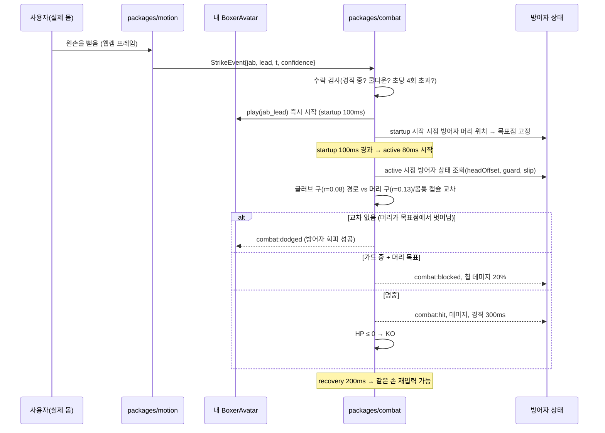
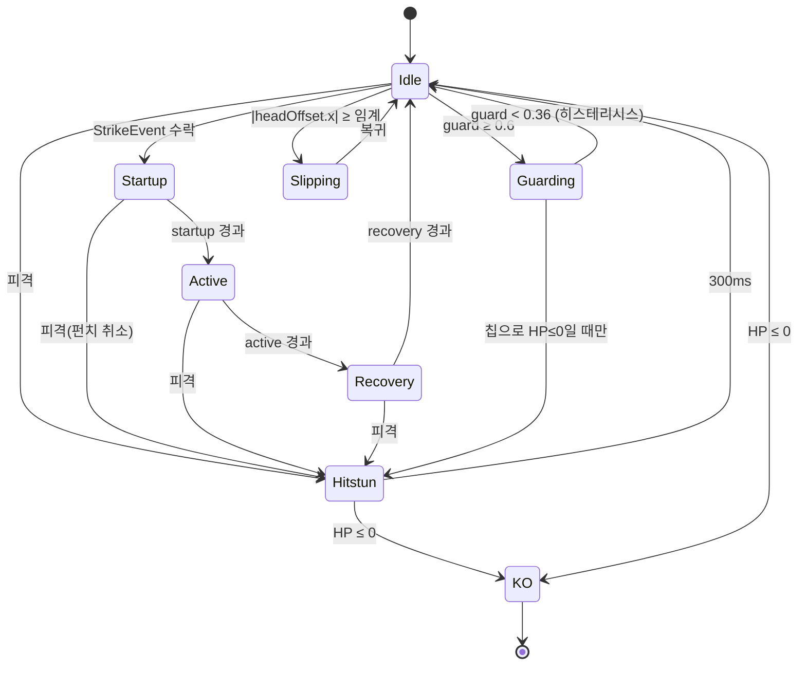
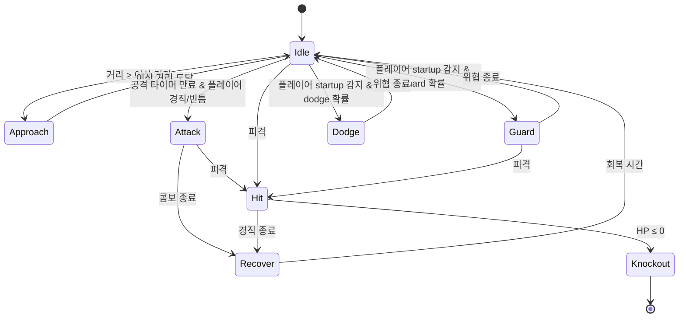

# 06. 1인칭 복싱 · 전투 판정 · AI 상대 설계

> 기준 문서: [designs/motion-boxing-arena.md](designs/motion-boxing-arena.md) Premise 2, 3 / 계약 C2, C3, C4, C6, C8.
> 요구사항 섹션 6(1인칭), 7(물리·판정), 8(AI 상대)을 다룬다. 구현 전 설계다.

## 1. 계층 분리

| 계층 | 책임 | 성격 | 위치 |
|---|---|---|---|
| 모션 인식 | 실제 동작 → `StrikeEvent`/`PoseState` | 학습 모델 + 알고리즘 | `packages/motion` |
| 전투 로직 | 기술 타임라인, 히트 판정, 데미지, 경직, KO | **게임 로직(결정적 순수 함수)** | `packages/combat` |
| 아바타 | 애니메이션 재생, 머리 오프셋, 가드 블렌드 | 렌더링 | `apps/web` `BoxerAvatar`(C4) |
| 게임 AI | 상대 복서 의사결정 | **FSM(학습 모델 아님)** | `packages/combat/ai` |
| 물리 엔진 | KO 래그돌 등 연출(선택) | Rapier | `apps/web` |

**게임 AI ≠ 생성형 AI.** 상대 복서는 상태 머신과 난수로 움직이며 학습된 모델이나 LLM을 쓰지 않는다. 생성형 AI는 캐릭터 외형 생성([04](04-AI-3D-PIPELINE.md))에만 쓰인다.

## 2. 펀치 판정 시퀀스



## 3. 전투 상수 (C6)

| 기술 | startup | active | recovery | 데미지 머리 / 몸통 | 가드 시 |
|---|---|---|---|---|---|
| jab | 100ms | 80ms | 200ms | 6 / 4 | 20% 칩 |
| straight | 160ms | 100ms | 300ms | 12 / 8 | 20% 칩 |
| (확장) hook | 200ms | 100ms | 350ms | 14 / 10 | 가드 측면 관통 규칙 별도 |

- HP 100. 피격 경직(hitstun) 300ms: 경직 중 새 펀치 입력 무시, 진행 중 펀치는 취소.
- 손별 쿨다운: 해당 손의 recovery 종료 전 입력 무시. 전체 초당 최대 4펀치(입력 스팸·오인식 폭주 방지).
- **중복 피격 방지**: 각 펀치에 `strikeId` 부여, 펀치 하나는 active 동안 최대 1회만 명중 처리.
- 라운드: MVP 1라운드 90초. HP 0 → KO. 시간 종료 → HP 비율 높은 쪽 승, 동률 무승부.
- 수치는 튜닝 대상이며 `packages/combat/constants.ts` 한 곳에서 관리한다.

## 4. 타격 판정 방식

### 4.1 사거리와 궤적은 게임이 정한다
- 실제 팔이 얼마나 뻗었는지, 상대와 실제 거리가 얼마인지는 판정에 쓰지 않는다. 펀치 이벤트가 오면 게임 글러브는 **정해진 사거리**로 정해진 궤적을 따라 날아간다.
- 목표점: startup 시작 시점의 방어자 머리 위치(머리 목표) 또는 몸통 중심(몸통 목표, 확장: 낮은 펀치).
- 판정: active 구간 동안 글러브 구가 목표점 근처를 지날 때, **그 시점의** 방어자 머리 구와 교차하는가. 방어자가 startup 동안 머리를 옮기면(슬립) 교차하지 않아 회피가 성립한다.
- 히트 볼륨은 공통 스켈레톤 정규값(C3: 머리 구 r=0.13m, 몸통 캡슐 r=0.18m·h=0.5m, 글러브 구 r=0.08m)이다. 캐릭터 메쉬가 커도 판정은 동일하다.

### 4.2 가드와 회피
- 가드: `PoseState.guard ≥ 0.6`이고 머리 목표 → `blocked`, 칩 데미지 20%. 몸통 목표는 MVP에서 가드 무관(확장에서 낮은 가드 추가).
- 회피: 방어자 머리 구 위치 = 기본 위치 + (`headX × 0.30m`, `headY × 0.15m`). 정규 오프셋 −1..1(±1 = 캘리브레이션한 최대 slip)을 게임 거리로 바꾼 값이며, 감쇠하지 않은 PoseState 값을 쓴다. 머리 구 r 0.13 + 글러브 구 r 0.08 = 0.21m이므로 **|headX| ≥ 0.70**이면 회피된다. slip hold: 판정 창은 `[max(aimLockTime, activeStart − 250ms), activeStart]`이고 조준 고정 이전 샘플은 제외한다. 유효 머리 위치는 이 창 안에서 조준점과 유클리드 거리가 가장 먼 단일 샘플이다(이산 상태가 아니라 연속값으로 계산). 조준점은 공격 시작 시점(AI는 telegraph 시작, 플레이어는 startup 시작)의 방어자 머리 위치에 고정되고 추적하지 않는다. 추적 손실 중에는 판정용 오프셋이 0(중앙)이 된다(결정 기록 C10·C12). 교차하지 않으면 `dodged`가 되고 회피 성공 수는 결과 통계에 기록한다. 모드별 회피 가능 창(AI telegraph / PvP 예측형)은 결정 기록 C10에 있다.
- 가드: active 시작 시점 `PoseState.guard ≥ 0.7`이면 `blocked`(MVP는 머리·몸통 모두). 동시 명중은 양쪽 모두 적용하고, 경직 중 입력은 거부한다(C17).

### 4.3 단순 해석적 판정 vs Rapier

| 항목 | 해석적(구·캡슐 교차) | Rapier 충돌 |
|---|---|---|
| 결정성 | 완전 결정적(같은 입력 → 같은 결과) | 결정적 모드 있으나 설정·버전 의존 |
| 서버 실행 | 순수 TS, Node에서 바로 | WASM 로드 필요(가능하나 추가 의존) |
| 테스트 | 단위 테스트 쉬움 | 물리 월드 셋업 필요 |
| 표현력 | 구·캡슐 몇 개면 복싱에 충분 | 복잡 형상·연쇄 충돌 |
| 성능 | 프레임당 수십 연산 | 충분히 빠르나 오버헤드 |
| 학습 비용 | 낮음 | 중간 |

**결정**: 판정은 `packages/combat`의 해석적 교차로 한다. Rapier(`@dimforge/rapier3d-compat` 0.21, Apache-2.0)는 **선택 사항**으로 KO 래그돌, 링 로프 반동 같은 클라이언트 연출에만 쓴다. 판정 결과에는 영향을 주지 않는다.

## 5. 상태 머신

### 5.1 파이터 상태



- Guarding/Slipping 중에도 펀치 입력은 가능(가드 상태는 연속값이므로 Startup과 병행 가능하되, 펀치 손은 가드 기여에서 제외).
- 경기 단계 상태 머신은 C8을 따른다([07-MULTIPLAYER.md](07-MULTIPLAYER.md)).

### 5.2 AI 상대 FSM



- AI는 플레이어의 `combat:strike_start`(startup 시작)를 **반응 시간 지연 후에** 인지한다. 실제 사람처럼 늦게 반응하게 만들어 난이도를 조절한다.
- **AI 공격 목표는 예비동작(telegraph) 시작 시점 플레이어 머리 위치로 고정**한다. 예비동작 동안 플레이어가 실제로 고개를 옮기면 회피된다. 이것이 핵심 게임 루프다.
- 예비동작은 시각적으로 명확하게: 어깨 젖힘 애니메이션 + 글러브 발광 + (Easy만) 화면 표시 "!".

### 5.3 난이도

| 파라미터 | Easy | Normal | Hard |
|---|---|---|---|
| 반응 시간(플레이어 펀치 인지) | 450ms | 300ms | 200ms |
| 공격 예비동작(telegraph) | 700ms | 500ms | 350ms |
| 회피 확률 | 10% | 25% | 40% |
| 가드 확률 | 20% | 35% | 45% |
| 공격 간격 | 2.5~3.5s | 1.6~2.4s | 1.0~1.6s |
| 최대 콤보 길이 | 1 | 2 | 3 |
| AI 데미지 배율 | 0.7 | 1.0 | 1.2 |

- Hard의 예비동작 350ms는 모션 인식 지연(약 150ms, [05](05-MOTION-RECOGNITION.md) §11)을 빼면 반응 여유가 약 200ms다. 실제 플레이로 검증 후 조정한다(PoC 필요).
- 구현 방식: FSM + 난이도 파라미터 테이블. Behavior Tree는 상태가 8개 수준이라 과하다고 판단해 채택하지 않는다(확장 시 재검토).

## 6. 1인칭 화면과 아바타 연결 (요구사항 6-A~H)

**A. 1인칭에서 내 캐릭터 표시**
양쪽 글러브 + 전완만 표시한다. 글러브 위치 = `가드 애니메이션 포즈`와 `추적 손목 위치(정규화 → 화면 하단 영역에 매핑, ±0.15m 클램프)`의 블렌드(가중치 0.3). 펀치 중에는 애니메이션 100%. 내 캐릭터 고유 글러브 텍스처를 사용해 "내 캐릭터"감을 준다.

**B. 상대에게 전달되는 내 움직임**
`StrikeEvent`(펀치 종류·손), `PoseState`(머리 오프셋, 가드 가중치) 두 가지뿐이다. 상대 화면에서 내 캐릭터는 이 값으로 공유 애니메이션 클립을 재생한다. 손가락·팔꿈치 각도 같은 세부 관절은 전송하지 않는다.

**C. 실제 몸과 3D 스켈레톤의 관절 차이 보정**
관절 단위 리타겟을 하지 않는 것이 보정 방법이다. 이벤트 → 공유 클립 재생이므로 사용자 팔 길이·체형·캐릭터 비율 차이가 판정이나 애니메이션에 전파되지 않는다. 머리 오프셋만 연속값으로 Head/Spine2 본에 감쇠 적용한다(최대 Spine2 15°, Head 10° 회전 + 골반 0.1m 이동).

**D. 실제 움직임 그대로 vs 게임용 보정**
게임용 애니메이션으로 보정한다. 실제 움직임을 그대로 반영하면 웹캠 노이즈·깊이 오차가 그대로 보이고 판정과 시각이 어긋난다. 연속값으로 반영하는 것은 머리 위치와 가드 블렌드뿐이다.

**E. 1인칭 카메라 흔들림 억제**
- 카메라 위치 = 기본 위치 + `headOffset × 0.25m`를 **임계 감쇠 스프링**(ω = 12rad/s)으로 추종한다. 카메라는 연출용이며 히트 판정은 위의 비감쇠 `× 0.30m` 값을 쓴다(C11).
- 이동량 클램프 ±0.25m(X), ±0.15m(Y).
- 머리 오프셋으로 yaw/pitch 회전은 하지 않는다(멀미 방지). 슬립 방향으로 roll만 최대 5°.
- 데드존: |headOffset| < 0.08은 0으로 처리(정지 시 떨림 제거).
- 피격 흔들림은 별도 레이어로 0.1초, 0.03m 이하. 설정에서 흔들림 강도 0~100% 조절.

**F. 실제로 이동하지 않는 게임 속 거리 조절**
파이터 간 거리는 게임이 자동 관리한다. 이상 거리 1.1m(정규 사거리 안)를 유지하며, 피격 시 0.15m 넉백 후 1초에 걸쳐 복귀. 상대 AI의 Approach 상태가 거리를 조절한다. 확장: 상체 앞/뒤 기울임으로 전진·후진.

**G. 상반신만 인식될 때 하체·전신 동작**
하체는 절차적으로 생성한다: 스탠스 유지 + 1.2Hz 바운스(골반 Y ±0.02m) + 펀치 시 체중 이동(골반 회전 10°) + 슬립 시 골반 측면 이동. 웹캠 하체 데이터는 사용하지 않는다. 상대 화면에서도 같은 절차적 하체를 쓴다.

**H. 부상 방지 플레이 공간·움직임 범위**
1.5m × 1.5m 공간 확보 확인, 카메라 거리 1.5~2.5m, "팔을 끝까지 펴지 않아도 인식됨" 안내, 손목 화면 이탈 경고, 추적 손실 시 자동 일시정지, 10분마다 휴식 권유. 세부 UI는 [10-UI-UX.md](10-UI-UX.md) §6.

## 7. 실제 거리와 게임 거리가 어긋나도 자연스러운 이유

- 판정은 실제 팔 길이와 무관하고, 글러브 궤적은 항상 상대 목표점을 향한다. 사용자는 "뻗으면 닿는다"를 일관되게 경험한다.
- 입력 지연(약 150ms)은 startup(100~160ms)과 겹쳐 체감이 줄어든다. 인식 순간 글러브가 출발하므로 "늦게 나간다"는 느낌이 작다.
- 회피는 실제 머리 이동량을 비율로 변환하므로 작은 슬립도 게임에서 충분히 큰 이동이 된다(캘리브레이션 최대값 기준).

## 8. `packages/combat` API 스케치

```ts
// 순수·결정적. 시간은 ms 정수, 고정 스텝 진행.
export interface FighterState {
  id: string; hp: number;
  phase: 'idle' | 'startup' | 'active' | 'recovery' | 'hitstun' | 'ko';
  current?: { strikeId: number; type: StrikeType; hand: Hand; startedAt: number; target: Vec3; hitApplied: boolean };
  handReadyAt: Record<Hand, number>;
  hitstunUntil: number;
  defense: { headOffset: Vec2; guard: number };
  stats: MatchStats;
}
export interface CombatWorld { t: number; fighters: [FighterState, FighterState]; distance: number; events: CombatEvent[]; }

export function submitStrike(w: CombatWorld, fighterId: string, ev: StrikeEvent): CombatWorld;   // 수락 여부 판단
export function submitPose(w: CombatWorld, fighterId: string, s: PoseState): CombatWorld;
export function step(w: CombatWorld, dtMs: number): CombatWorld;   // 타임라인 진행 + 판정 + 이벤트 생성
export function hitVolumes(f: FighterState, side: 0 | 1, distance: number): HitVolumes;
export function resolveStrike(att: FighterState, def: FighterState, at: number): 'hit' | 'blocked' | 'dodged';
```

- 싱글: 클라이언트가 60Hz 고정 스텝으로 `step`. 멀티: 서버가 30Hz(33ms)로 `step`, 클라이언트는 결과 이벤트를 받아 연출만 한다([07](07-MULTIPLAYER.md)).
- 같은 함수를 양쪽에서 쓰므로 "싱글에서 맞던 게 멀티에서 안 맞는" 규칙 차이가 생기지 않는다. 단위 테스트는 시나리오 표(입력 타임라인 → 기대 이벤트)로 작성한다.
- AI 상대(`packages/combat/ai`)는 `CombatWorld`를 읽고 `StrikeEvent`/`PoseState`를 생성하는 또 하나의 입력원이다. 난수는 시드 고정 PRNG를 써서 리플레이·테스트를 재현 가능하게 한다.
