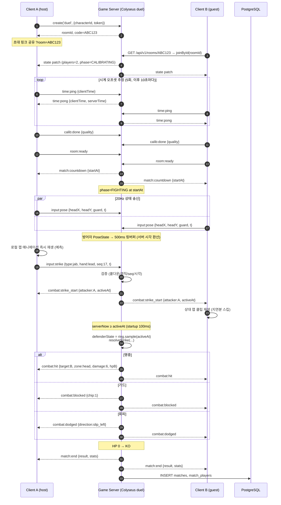
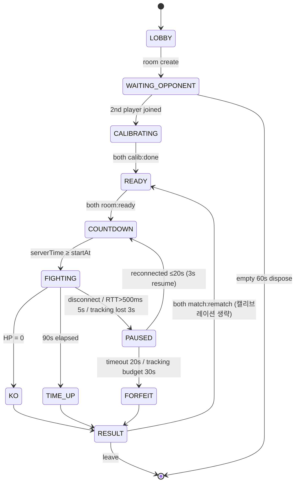

# 07. 실시간 멀티플레이어 설계

> 상태: 구현(`apps/server/src/realtime`, `apps/web/src/net`, `apps/web/src/game/OnlineSession.ts`). 기준 문서: `docs/designs/motion-boxing-arena.md`의 C2, C6, C7, C8.
> 스택: Colyseus 0.18(서버, MIT), @colyseus/sdk 0.18(클라이언트, MIT). `colyseus.js`는 0.16.22에서 멈췄으므로 사용하지 않는다.

---

## 1. 핵심 원칙

1. **영상은 보내지 않는다.** 포즈 추론은 각자 브라우저에서 돌리고, 네트워크에는 행동 이벤트(`StrikeEvent`)와 저주기 상태(`PoseState`)만 보낸다.
2. **서버 권한(Server-authoritative).** HP, 데미지, 쿨다운, 승패는 서버만 결정한다. 클라이언트는 결과를 "요청"할 뿐이다.
3. **클라이언트는 자기 애니메이션만 예측한다.** 내 펀치 모션은 즉시 재생하고, 명중 이펙트·데미지 숫자는 서버 확인 후 표시한다.
4. **방어자 우선(defender-favored).** 판정은 서버 시각의 방어자 실제 상태로 한다. 화면에서 고개를 뺐다면 피한 것이다. 이 게임의 재미는 "실제로 피하는 것"에 있기 때문이다.
5. **같은 전투 코드.** `packages/combat`의 순수 함수를 싱글(클라)과 멀티(서버)가 그대로 공유한다.

---

## 2. 영상 전송 필요성 검토

| 방식 | 페이로드 | 대역폭(추정, 1인 업링크) | 개인정보 | 판정에 필요? |
|---|---|---|---|---|
| 원본 웹캠 영상 (WebRTC 720p) | 프레임 | 1.5~2.5 Mbps | 얼굴·방 내부 노출 | 아니오 |
| 랜드마크 33점 × (x,y,z,vis) float32 @30Hz | 33×4×4 = 528B/프레임 | 약 16 KB/s ≈ 127 kbps | 체형 정보 일부 | 아니오 (과잉) |
| **이벤트 + PoseState @20Hz** (채택) | PoseState 약 20B + 이벤트 수 회/초 | 약 0.5~1 KB/s ≈ 4~8 kbps | 머리 오프셋·가드 값뿐 | 충분 |

- 상대 화면의 내 캐릭터는 "행동 이벤트 → 게임 애니메이션"으로 재생되므로 원시 관절 데이터가 필요 없다.
- 랜드마크 원본 전송은 확장(관전 모드·리플레이 연구용)에서만 opt-in으로 검토한다.
- 결론: **영상·랜드마크 원본은 전송·저장하지 않는다.** (Premise 7)

---

## 3. 클라이언트 / 서버 책임

| 기능 | 클라이언트 | 게임 서버 |
|---|---|---|
| 웹캠 캡처, 포즈 추론, 동작 분류 | ✅ (로컬 전용) | ❌ |
| 캘리브레이션 | ✅ 수행 후 `calib:done` 통보 | 완료 여부 기록 |
| 내 펀치 애니메이션 재생 | ✅ 즉시(예측) | ❌ |
| 펀치 유효성(쿨다운, 경직, 속도 제한) | 로컬 사전 차단(UX용) | ✅ **최종 결정** |
| 명중/가드/회피 판정 | ❌ (싱글 모드에서만 로컬) | ✅ `packages/combat` |
| HP, 타이머, KO, 승패 | 표시만 | ✅ |
| 상대 캐릭터 렌더 | 보간 버퍼(약 100ms)로 재생 | 상태 브로드캐스트 |
| 머리 오프셋/가드 | 20Hz 송신 | 히스토리 링버퍼(500ms) 저장 |
| 결과 저장 | ❌ | ✅ Postgres |
| 시계 동기화 | 오프셋 추정 | 서버 시각 기준 제공 |

---

## 4. 요구사항 12항목 설계

### 4.1 게임 룸 생성 및 참가
- 룸 타입 `duel`(최대 2명). 생성 시 서버가 6자리 룸 코드 발급(대문자+숫자, 혼동 문자 `0 O 1 I` 제외).
- 생성: `client.create('duel', { characterId, nickname, token })`.
- 참가: 코드 입력 → REST `GET /api/v1/rooms/:code`로 roomId 조회 → `client.joinById(roomId, {...})`. (Colyseus `filterBy`로 코드 매칭을 구현할 수도 있다. 어느 쪽이 더 단순한지는 구현 시 결정.)
- 3명째 참가 요청은 `ROOM_FULL`로 거절.

### 4.2 친구 초대
- 초대 링크 `https://<host>/?room=ABC123`. 링크로 접속하면 캐릭터 선택 → 웹캠 설정 → 자동 참가.
- 복사 버튼 + (확장) QR 코드. 공개 매칭(랜덤 매칭)은 확장 범위.
- 코드 유효 시간: 룸이 존재하는 동안. 빈 룸은 60초 후 dispose.

### 4.3 플레이어 준비 상태
- Schema 필드 `players[sessionId].ready`, `calibrated`, `characterId`, `connected`.
- 클라이언트는 `room:ready`를 토글로 보낸다. 양쪽 모두 `ready && calibrated`이면 서버가 `COUNTDOWN`으로 전환.

### 4.4 카메라 캘리브레이션 완료 확인
- 캘리브레이션은 로컬에서 진행(05-MOTION-RECOGNITION 참조). 완료 시 `calib:done { quality: 0..1, profileHash }` 송신.
- 서버는 `quality < 0.5`이면 경고 플래그만 세우고 막지는 않는다(시연 유연성).
- 재대결(REMATCH)에서는 캘리브레이션을 생략하고 바로 READY로 간다(C8).

### 4.5 경기 시작 동기화
- **시계 오프셋 추정**: 룸 입장 직후 `time:ping` 5회 → 서버가 `serverTime` 회신 → 클라이언트가 RTT 최소 샘플로 `offset = serverTime + RTT/2 - clientNow` 계산(NTP 단순화). 경기 중 10초마다 재샘플, EMA로 보정.
- 서버는 `match:countdown { startAt: serverTime + 3000 }`를 보낸다. 클라이언트는 `startAt - offset`에 로컬 타이머를 맞춰 "3-2-1-FIGHT" 연출.
- 서버 `FIGHTING` 진입은 `startAt` 정각. 그 이전 `input:strike`는 무시.

### 4.6 입력 이벤트 전송
- `input:strike` (C2 `StrikeEvent`): 감지 즉시 1회 송신. `seq`는 클라이언트 단조 증가.
- `input:pose` (C2 `PoseState`): 20Hz 고정 송신. 값이 변하지 않아도 보낸다(생존 신호 겸용).
- 전송 채널: Colyseus WebSocket 메시지. 바이너리 직렬화는 기본 msgpack 사용.

### 4.7 위치 및 애니메이션 동기화
- MVP에서 두 선수의 거리는 게임이 고정·자동 조절한다(링 위 이동 없음). 따라서 "위치 동기화"는 머리 오프셋·가드 가중치·현재 액션만으로 충분하다.
- 서버 상태(Schema, 30Hz 패치): `phase, timer, players[].hp, players[].action, players[].actionStartedAt, players[].stunUntil`.
- 상대 렌더: 수신한 PoseState를 **약 100ms 보간 버퍼**로 재생(두 샘플 사이 선형 보간). 상대 펀치는 `combat:strike_start`를 받는 즉시 해당 클립을 재생하되, 경과 시간만큼 클립을 앞당겨 시작한다(늦게 받은 만큼 스킵).

### 4.8 서버 권한 기반 판정
1. `input:strike` 수신 → 검증(4.11) → 통과 시 `strikeStart = serverNow`, `activeAt = strikeStart + startup(C6)`.
2. 즉시 양쪽에 `combat:strike_start { attacker, type, hand, activeAt }` 브로드캐스트.
3. 서버 틱(30Hz)에서 `serverNow >= activeAt`인 펀치를 처리. 방어자 상태는 **링버퍼에서 `activeAt` 시점 샘플**을 꺼낸다(없으면 가장 가까운 과거 샘플).
4. `packages/combat.resolveStrike(attacker, defenderStateAt(activeAt), strike)` → `hit | blocked | dodged`.
5. HP 갱신, 경직 설정, `combat:hit | combat:blocked | combat:dodged` 브로드캐스트. HP 0이면 `KO`.

### 4.9 네트워크 지연 보정
- **startup이 RTT를 가린다.** jab startup 100ms, straight 160ms. 내 화면에서는 펀치가 즉시 시작되므로, 업링크 지연(RTT/2, 국내 약 15~50ms 추정)은 startup 안에 숨는다.
- **방어자 우선.** 방어자의 PoseState가 서버에 도착하는 지연(RTT/2 + 최대 50ms 샘플 간격)만큼 회피가 늦게 반영될 수 있다. 서버는 방어자 샘플의 클라이언트 타임스탬프(`t` + offset)를 서버 시각으로 환산해 링버퍼에 넣는다. 판정은 이 환산 시각 기준이므로 방어자가 실제로 움직인 시점이 존중된다. 필요하면 판정을 최대 `REWIND_GRACE = 80ms` 늦춰 늦게 도착한 회피 샘플을 반영한다(PoC 필요: 체감 테스트로 값 결정).
- **명중 이펙트는 서버 확인 후.** 공격자 화면에서 타격음·화면 흔들림은 `combat:hit` 수신 시 재생. 지연은 약 RTT/2(추정 15~50ms)라서 체감이 크지 않을 것으로 추정한다(PoC 필요).
- RTT > 250ms이면 HUD에 "네트워크 불안정" 표시. 500ms를 넘는 상태가 5초 이상 지속되면 PAUSED 처리.

### 4.10 연결 끊김 및 재접속
- `onLeave(client, consented=false)` → `phase = PAUSED`, 타이머 정지, `allowReconnection(client, 20)`.
- 20초 안에 복귀하면 이전 phase(FIGHTING)로 돌아가 3초 카운트다운 후 재개. 실패하면 `FORFEIT`로 남은 사람 승리.
- 클라이언트는 `reconnectionToken`을 sessionStorage에 보관(새로고침 대응).
- 양쪽 모두 끊기면 룸 dispose, 결과는 `ABANDONED`로 저장.

### 4.10.1 추적 손실로 인한 PAUSED (결정 기록 C12)
- 어깨 visibility < 0.5이거나 포즈가 미검출된 프레임부터 클라이언트는 `input:pose`를 `headX=0, headY=0, guard=0`으로 보낸다. 화면 밖으로 몸을 빼는 동작은 회피로 인정되지 않는다.
- 손실이 3초 지속되면 클라이언트가 `trackingLost`를 보고하고, 서버는 `match:paused { reason: "TRACKING_LOST" }`를 보낸다. 20초 안에 복귀하지 못하면 FORFEIT이다.
- **누적 예산**: 플레이어당 경기 중 추적 손실 PAUSED를 합쳐 30초를 넘으면 FORFEIT이다. 들락날락하며 경기를 끄는 행동을 막기 위해서다.

### 4.11 부정행위 방지 (현실적 범위)
| 검사 | 규칙 |
|---|---|
| 속도 제한 | 손별 쿨다운(recovery 종료 전 입력 무시), 전체 초당 4펀치 초과 무시 |
| 경직 | `stunUntil` 이전 펀치 무시 |
| 순서 | `seq` 단조 증가가 아니면 무시(중복·재전송 방지) |
| 타임스탬프 | `|t + offset - serverNow| > 1000ms`이면 무시, 반복되면 경고 |
| 포즈 생존 | 1초 이상 `input:pose` 미수신이면 그 사이 펀치 무시. 3초면 PAUSED 후보 |
| 값 범위 | `headX/headY ∈ [-1,1]`, `guard ∈ [0,1]`, `confidence ∈ [0,1]` zod 검증 |
| phase | FIGHTING 외 입력 무시 |

- **솔직한 한계**: 입력이 실제 카메라 동작에서 나왔는지는 서버가 증명할 수 없다. 개발자 도구로 이벤트를 위조하는 매크로는 막을 수 없다. MVP에는 랭크전이 없으므로 이 위험을 수용한다. 랭킹 도입 시(확장) 서버 측 행동 통계 이상 탐지와 리플레이 신고 기능을 검토한다.

### 4.12 경기 종료 및 결과 저장
- 종료 조건: `KO`(HP 0), `TIME_UP`(90초, HP 비율 판정, 동률이면 무승부), `FORFEIT`.
- 서버가 집계: 펀치 수(손별·종류별), 명중/가드/회피 수, 명중률, 회피 성공률, 경기 시간.
- `match:end { result, stats }` 브로드캐스트 후 Postgres `matches`, `match_players`에 저장(09-DATA-MODEL).
- 저장 실패는 3회 재시도 후 로그만 남긴다. 결과 화면은 브로드캐스트 데이터로 그리므로 영향받지 않는다.
- 캐릭터 교체: RESULT 단계에서 `match:rematch` **전에** `player:character { characterId }`를 보낸다(새로 생성된 3D 캐릭터 자동 교체 포함). 서버는 READY 이전에만 수락하고, READY 이후에 생성이 끝나면 그다음 경기에 적용한다.
- `match:rematch` 양쪽 동의 → 같은 룸에서 READY로 복귀.

---

## 5. 경기 동기화 시퀀스

---

## 6. 경기 단계 상태 머신 (C8)

---

## 7. 서버 틱과 송신 주기

| 항목 | 주기 | 근거 |
|---|---|---|
| 서버 시뮬레이션 틱 | 30Hz (33ms) | 펀치 active 최소 80ms → 틱 2개 이상 겹침 보장 |
| Schema 패치 | 30Hz (`setPatchRate(33)`) | 기본 20Hz에서 상향 |
| PoseState 업링크 | 20Hz (50ms) | 회피 반영 지연과 대역폭 균형 |
| 시계 재동기 | 10초 | 드리프트 보정 |
| 링버퍼 길이 | 500ms (약 10샘플) | REWIND_GRACE 80ms + 최대 RTT 여유 |

---

## 8. 테스트 모드

| 모드 | 구성 | 용도 |
|---|---|---|
| (a) 단일 브라우저 개발 모드 | 탭 1개. 플레이어 A는 웹캠, 플레이어 B는 **키보드**(`J`=jab, `K`=straight, `A/D`=slip, `S`=guard) 또는 **랜드마크 리플레이 파일** 입력 | 서버 없이(로컬 combat) 또는 로컬 서버로 판정·UI 개발 |
| (b) 같은 PC 두 탭 | 탭1 웹캠, 탭2 리플레이/키보드. 둘 다 `localhost` Colyseus 접속 | 네트워크 경로 전체 검증, 인위 지연 주입(서버 측 `SIM_LATENCY_MS`) |
| (c) 실제 원격 1:1 | 두 대의 PC, 배포 서버(HTTPS/WSS) | 최종 시연, RTT·불일치 측정 |

- 입력 소스는 `InputSource` 인터페이스(`webcam | keyboard | replay`)로 추상화해서 세 모드가 같은 클라이언트 코드를 쓴다.
- 서버에 `SIM_LATENCY_MS`, `SIM_JITTER_MS`, `SIM_LOSS` 환경변수를 두어 지연 상황을 재현한다(12-PERFORMANCE-TESTING 참조).

---

## 9. 미결 사항 / PoC 필요

- REWIND_GRACE 값(0~120ms)의 체감 공정성: P4 PoC에서 공격자·방어자 양쪽 설문으로 결정.
- 보간 버퍼 100ms가 상대 회피 동작을 너무 늦게 보여주는지: 60/100/150ms 비교.
- 룸 코드 매칭 방식(REST 조회 vs `filterBy`): 구현 단순성으로 결정.
- 학교 네트워크에서 WSS 포트(443) 외 차단 여부: 배포 환경 확인 필요.
