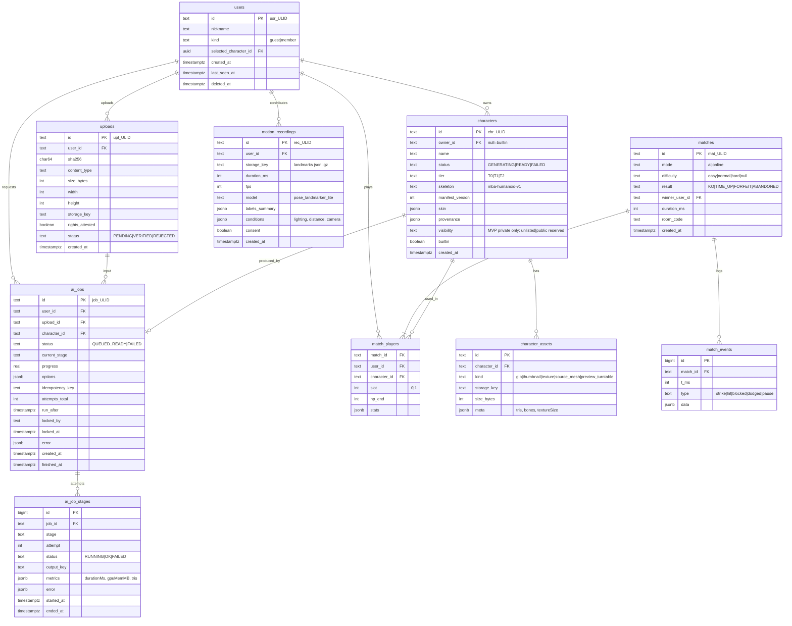

# 09. 데이터 모델

> 상태: 구현(`apps/server/src/db/migrations.ts`). 기준: `docs/designs/motion-boxing-arena.md`의 C3, C5, C9.
> DB: PostgreSQL SQL — `DATABASE_URL`이 있으면 `pg`, 없으면 내장 PGlite. ORM 없이 SQL 직접 사용. 스토리지: 로컬 파일 시스템(`DATA_DIR/files`, §6 레이아웃 동일). S3 호환 스토리지는 배포 시 검토.

---

## 1. 원칙

1. **영상은 저장하지 않는다.** 저장되는 사람 관련 데이터는 업로드한 캐릭터 이미지와, 본인이 동의한 경우의 랜드마크 좌표 녹화뿐이다.
2. **외형과 게임 로직은 분리한다.** 캐릭터 테이블은 외형(에셋)만 가진다. 히트 볼륨·데미지·속도는 공통 상수(`packages/combat`)이며 캐릭터별로 바뀌지 않는다. `stats`는 MVP에서 표시용(cosmetic)이다.
3. **작업은 단계별로 기록한다.** 실패한 단계부터 다시 실행할 수 있도록 단계별 시도와 산출물 키를 남긴다.
4. **큐도 Postgres로 처리한다.** MVP에서는 Redis를 쓰지 않는다.

---

## 2. ERD



---

## 3. 테이블 상세

### 3.1 `users`
| 컬럼 | 타입 | 제약 |
|---|---|---|
| id | text | PK |
| nickname | varchar(16) | not null |
| kind | text | check in ('guest','member'), default 'guest' |
| selected_character_id | text | FK characters(id) on delete set null |
| created_at / last_seen_at | timestamptz | default now() |
| deleted_at | timestamptz | soft delete 표시 |

### 3.2 `uploads`
- 인덱스: `unique (user_id, sha256)`. 같은 사용자가 같은 이미지를 올리면 기존 행을 재사용한다.
- `rights_attested boolean not null check (rights_attested = true)`

### 3.3 `characters`
- 인덱스: `(owner_id, created_at desc)`, `(builtin) where builtin`.
- `provenance` 예: `{ "imageModel": "trellis2", "modelVersion": "...", "seed": 42, "rigger": "make-it-animatable|blender-auto|rigid", "pipelineVersion": "0.3.0" }`
- `skin` (T0 또는 추가 장식): `{ "palette": ["#e63946","#1d3557","#f1faee"], "decals": [{ "slot": "chest", "assetKey": "..." }] }`
- 내장 캐릭터(builtin)는 `owner_id null`, 시드 마이그레이션으로 등록한다.

### 3.4 `ai_jobs` / `ai_job_stages`
- `ai_jobs` 인덱스:
  - `(status, run_after) where status in ('QUEUED','RETRY_WAIT')`: 큐 폴링용
  - `unique (user_id, idempotency_key)`
  - `(user_id, created_at)`: 일일 생성 제한 카운트
- `status` 값: `QUEUED, PREPROCESSING, GENERATING, POSTPROCESSING, RIGGING, VALIDATING, EXPORTING, READY, FAILED, RETRY_WAIT`
- `ai_job_stages`는 시도 1회당 1행이다. `metrics`가 12-PERFORMANCE-TESTING의 3D 지표 원천 데이터가 된다.

### 3.5 `matches` / `match_players` / `match_events`
- `match_players` PK `(match_id, slot)`, 인덱스 `(user_id, match_id)`.
- `stats` 예: `{ "punches": {"jab": 31, "straight": 14}, "hits": 22, "blocked": 9, "dodgesAttempted": 12, "dodgesSucceeded": 8, "accuracy": 0.49, "dodgeRate": 0.67 }`
- `match_events`는 **선택**이다. 판정 불일치 분석용으로 온라인 경기의 strike/hit/dodge만 기록하고 pose는 기록하지 않는다. 기능 플래그로 켜며 30일 후 삭제한다.

### 3.6 `motion_recordings` (데이터셋)
- 랜드마크 좌표(33점 x,y,z,visibility + worldLandmarks)와 라벨 이벤트만 담은 `jsonl.gz`. **영상 프레임은 담지 않는다.**
- `consent = true`인 행만 저장할 수 있다. 수집은 팀원과 동의한 외부 참가자로 한정한다(12-PERFORMANCE-TESTING).
- 파일 포맷(1줄 = 1프레임):
```json
{"t": 1033.4, "lm": [[0.51,0.32,-0.41,0.99], ...33], "wlm": [[0.01,-0.55,-0.20,0.99], ...33], "label": null}
{"t": 1066.7, "lm": [...], "wlm": [...], "label": {"event": "jab", "hand": "lead", "phase": "start"}}
```

---

## 4. 캐릭터 매니페스트 `character.json` (C5 전체 예시)

```json
{
  "id": "chr_01JA7Q8M3Z5V2K",
  "name": "Tin Can Tony",
  "ownerId": "usr_01JA7P1X9R",
  "manifestVersion": 3,
  "skeleton": "mba-humanoid-v1",
  "tier": "T1",
  "glbUrl": "https://assets.example.com/characters/chr_01JA7Q8M3Z5V2K/v3/model.glb",
  "thumbnailUrl": "https://assets.example.com/characters/chr_01JA7Q8M3Z5V2K/v3/thumb.webp",
  "scale": 1.0,
  "bindMode": "rigid",
  "skin": {
    "palette": ["#9aa5b1", "#e63946", "#1d3557"],
    "decals": []
  },
  "stats": { "displayPower": 3, "displaySpeed": 4 },
  "assetMeta": { "tris": 14820, "bones": 22, "textureSize": 1024, "glbBytes": 2311044 },
  "provenance": {
    "sourceUploadSha256": "9f2c…",
    "imageModel": "trellis2",
    "modelVersion": "UNVERIFIED-at-design-time",
    "seed": 42,
    "rigger": "rigid",
    "pipelineVersion": "0.3.0",
    "createdAt": "2026-11-20T08:12:44Z"
  },
  "license": {
    "userAttestedRights": true,
    "visibility": "private"
  }
}
```

- `stats`는 표시용이다. 전투 수치는 `packages/combat`의 공통 상수를 쓴다.
- 히트 볼륨은 매니페스트에 없다. 공통 스켈레톤 정규값(C3)으로 고정이다.
- 매니페스트는 버전별 불변이다. 재생성·재리깅 시 `manifestVersion`을 올리고 새 경로에 쓴다.

---

## 5. 작업 큐 쿼리

워커(Python)가 1~2초 간격으로 폴링한다.

```sql
-- 작업 하나 점유
WITH next AS (
  SELECT id FROM ai_jobs
  WHERE status IN ('QUEUED', 'RETRY_WAIT')
    AND run_after <= now()
  ORDER BY created_at
  FOR UPDATE SKIP LOCKED
  LIMIT 1
)
UPDATE ai_jobs j
SET status = COALESCE(j.current_stage, 'PREPROCESSING'),
    locked_by = $1,           -- worker id
    locked_at = now()
FROM next
WHERE j.id = next.id
RETURNING j.*;
```

- **재시작 지점**: `current_stage`가 비어 있으면 PREPROCESSING부터, 아니면 실패했던 단계부터 시작한다. 이전 단계 산출물은 `ai_job_stages.output_key`에서 읽는다.
- **재시도·백오프**: `retryable` 오류이면 `status='RETRY_WAIT'`, `run_after = now() + interval '30 seconds' * 2^(attempt-1)`로 설정한다. 단계당 최대 2회, 초과하면 `FAILED`.
- **비재시도 오류**(예: `NOT_HUMANOID_AND_RIGID_FAILED`, `IMAGE_UNSAFE`)는 즉시 `FAILED`. 클라이언트가 T0 스킨 모드를 제안한다.
- **좀비 작업 회수**: `locked_at < now() - interval '10 minutes'`이고 진행 중 상태인 작업은 주기 작업이 `RETRY_WAIT`로 되돌린다(워커 크래시 대응).
- **진행률**: 단계 가중치 고정(PRE 0.05, GEN 0.45, POST 0.1, RIG 0.25, VAL 0.1, EXP 0.05)과 단계 내 진행으로 계산한다.

---

## 6. 오브젝트 스토리지 레이아웃

```
uploads/{userId}/{sha256}.{png|jpg|webp}             원본 업로드
jobs/{jobId}/PREPROCESSING/cutout.png                 배경 제거 + 정규화 이미지
jobs/{jobId}/PREPROCESSING/pose2d.json                2D 관절 추정(휴머노이드 판정용)
jobs/{jobId}/GENERATING/raw.glb                       이미지→3D 원본 출력
jobs/{jobId}/POSTPROCESSING/clean.glb                 정리·감축·정규화 메쉬
jobs/{jobId}/RIGGING/rigged_smooth.glb | rigged_rigid.glb
jobs/{jobId}/VALIDATING/report.json                   변형 품질 지표, 선택된 bindMode
jobs/{jobId}/VALIDATING/poses/*.webp                  테스트 포즈 렌더(디버그)
characters/{characterId}/v{n}/model.glb               최종 게임용(meshopt/Draco 압축)
characters/{characterId}/v{n}/thumb.webp
characters/{characterId}/v{n}/character.json
builtin/characters/{name}/...                         내장 캐릭터
recordings/{userId}/{recId}.jsonl.gz                  동의한 랜드마크 녹화
```

- `jobs/` 하위는 중간 산출물이다. 30일 후 수명주기 규칙으로 삭제한다(분석용 `report.json`은 별도 보관 가능).
- `characters/`는 CDN 공개 경로로 서빙한다. private 캐릭터는 추측하기 어려운 ID + 서명 URL을 쓴다(MVP는 ULID 비공개성에 의존, 추정 수준의 보호임을 명시).

---

## 7. 보존·삭제·개인정보

| 데이터 | 보존 | 삭제 |
|---|---|---|
| 웹캠 영상 | **수집 안 함** | — |
| 업로드 원본 이미지 | 캐릭터 존속 기간 | 캐릭터 삭제 또는 `DELETE /me`(확장) 시 즉시 |
| 작업 중간 산출물 | 30일 | 수명주기 자동 삭제 |
| 캐릭터 최종 에셋 | 계정 존속 기간 | 사용자 요청 시 |
| 경기 결과 | 1년 | 계정 삭제 시 user_id 익명화 |
| match_events | 30일 | 자동 |
| 랜드마크 녹화 | 프로젝트 종료 + 평가 보고 후 폐기(최대 6개월) | 참가자 요청 시 즉시 |
| 게스트 계정 | 마지막 접속 후 90일 | 연쇄 삭제 |

- 랜드마크 좌표도 체형·움직임 습관이라는 개인정보가 될 수 있으므로 수집 동의서와 저장 위치를 문서화한다.
- 업로드 이미지는 모델 학습에 쓰지 않는다. 사용하는 생성 모델 라이선스 조건과 별개로 팀 정책으로 명시한다(14-OPEN-SOURCE-LICENSES 참조).
