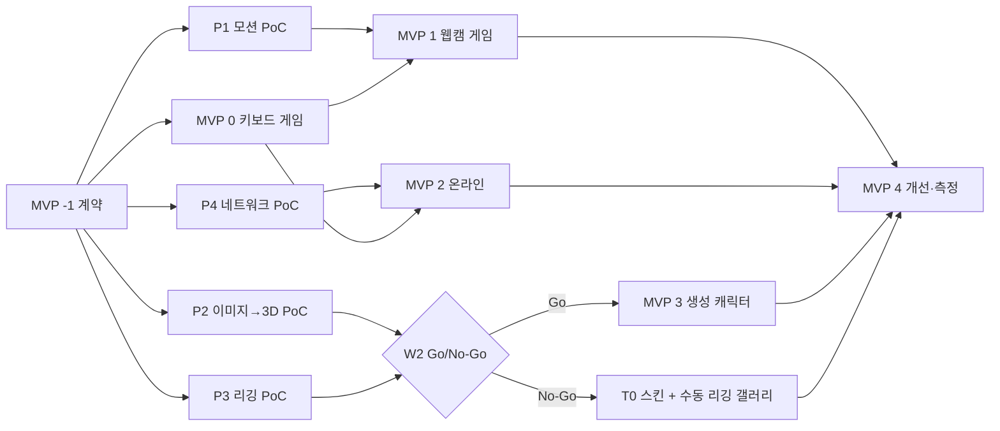

# 11. MVP 단계와 8주 로드맵

> 상태: 계획. 주차별 완료 기준은 **시연 가능 여부**로 판정한다("코드가 있다"가 아니라 "돌아간다").

## 1. 제안 순서에서 바꾼 점

요구사항의 순서(MVP0 → 1 → 2 → 3 → 4)는 의존성은 맞지만, **불확실성이 가장 큰 2D→3D·리깅을 MVP3(5주차 이후)에 두면 실패를 너무 늦게 안다.** 다음과 같이 바꾼다.

| 변경 | 내용 | 이유 |
|---|---|---|
| **MVP -1 (계약 동결)** 신설 | W1 초반 2일, `packages/shared`에 타입·스키마·상수만 커밋 | 7명이 병렬로 작업해도 마지막에 붙도록 |
| **기술 PoC 4개를 W1~W2에 병렬** | P1 모션, P2 이미지→3D, P3 리깅, P4 네트워크 | 위험 기능의 Go/No-Go를 2주차에 결정 |
| **리플레이 입력을 MVP0에 포함** | 랜드마크 녹화/재생 도구 | 웹캠 없이 게임·분류기 테스트 가능, 데모 안전망 |
| **T0 스킨 모드를 MVP1에 포함** | 이미지 색·데칼을 기본 복서에 적용 | 3D 생성 실패와 무관하게 "내 캐릭터" 시연 보장 |
| MVP2(온라인)와 MVP3(생성)를 **병렬 트랙**으로 | 서버 담당과 AI 담당이 다른 사람 | 서로 의존성 없음 |

## 2. MVP 단계 정의

| 단계 | 범위 | 완료 기준 | 시연 필수 여부 |
|---|---|---|---|
| MVP -1 | 모노레포 골격, C1~C9 타입, CI(lint/test), 문서 | `pnpm test` 녹색, 타입 패키지 v0 태그 | — |
| MVP 0 | 경기장, 기본 복서(공통 스켈레톤), 키보드 조작, `packages/combat`, AI 상대 FSM v1, 리플레이 입력 | 키보드로 AI 상대를 KO 가능 | ✅ |
| MVP 1 | MediaPipe 웹캠, 캘리브레이션, 잽/스트레이트/가드/좌우 회피, 디버그 오버레이, T0 스킨 | **웹캠만으로 AI 상대와 1경기 완주** | ✅ (핵심 경로) |
| MVP 2 | Colyseus 룸, 초대 링크, 서버 판정, 재접속 | 두 대의 PC로 원격 1경기 완주 | 조정 가능 |
| MVP 3 | 업로드, 생성 작업 큐, 이미지→3D, 리깅(T1/T2), 게임 적용 | 사전 준비 이미지 5장 중 4장 이상 T1 이상으로 게임 투입 | 조정 가능 |
| MVP 4 | 정확도·성능 개선(전후 비교), UX 다듬기, 테스트 자동화, 배포 | 성공 기준 지표 측정 보고서 | ✅ (포트폴리오) |
| 확장 | 훅·어퍼컷·숙이기, 랭킹, 공개 갤러리, 종목 확장, 홀로그램 | — | ❌ |

## 3. 의존성 그래프

**임계 경로**: MVP -1 → MVP 0 → P1 → MVP 1 → MVP 4. 이 경로의 담당자는 다른 트랙 지원에 빠지지 않는다.

## 4. 팀 역할 (7명, 조정 가능)

| 역할 | 코드 | 주 책임 | 필요 역량 | 겸임 가능 |
|---|---|---|---|---|
| Game Client Lead | **GC** | Three.js 씬, `BoxerAvatar`, 1인칭 카메라, 애니메이션 블렌딩, 통합 책임 | TS, Three.js | — |
| UI/UX & Design | **UX** | React 화면 10종, HUD, 디자인 시스템, 예외 UI, 그리기 템플릿 | React, 디자인 | 3D 경기장 아트 |
| Motion Engineer | **MO** | MediaPipe, `packages/motion`, 캘리브레이션, 데이터 수집·평가 | TS, 신호처리, ML 기초 | — |
| Server Engineer | **SV** | Colyseus, `packages/combat` 서버 적용, 지연 보정, 재접속 | Node, 네트워크 | AI 상대 FSM |
| Backend/Infra | **BE** | Fastify REST, DB, 스토리지, 배포, CI, 게스트 인증 | Node, SQL, Docker | — |
| AI 3D Engineer | **AI** | 이미지→3D PoC·워커·큐, GPU 운영, 품질 측정 | Python, PyTorch | — |
| 3D/Rigging TA | **TA** | 공통 스켈레톤, 애니메이션 라이브러리, 리깅·검증기, Blender 스크립트, 기본 복서 | Blender, Python | 경기장 모델 |

`packages/combat`의 **원 저작자는 GC**, 서버 적용은 SV. AI 상대 FSM은 SV 또는 GC 중 여유 있는 쪽(W2 결정).
인원이 부족하면 합치는 순서: UX+GC 일부, BE+SV, AI+TA. **MO는 겸임하지 않는다**(임계 경로).

## 5. 8주 로드맵

### 주차별 요약

| 주 | 목표 | 주요 구현 | 난이도 | 기술 위험 | 통합 |
|---|---|---|---|---|---|
| W1 | 계약 동결 + PoC 4종 시작 | 모노레포, C1~C9 타입, 기본 씬, P1~P4 | 중 | 계약 누락 | 계약 리뷰(D2) |
| W2 | MVP 0 + PoC 결론 | 키보드 게임, combat, AI FSM v1, 리플레이, Go/No-Go | 중 | 3D 모델 GPU 확보 | **I-0: 키보드 게임** |
| W3 | MVP 1 핵심 경로 | 웹캠→이벤트→게임, 캘리브레이션, 디버그 오버레이, T0 스킨 | 상 | 펀치 오인식 | **I-1: 웹캠 vs AI (핵심 경로)** |
| W4 | 데이터·서버·워커 기반 | 녹화 데이터셋 v1 + 평가 기준선, Colyseus 룸·서버 판정, 워커 E2E(UI 없음) | 상 | 판정 불일치 | — |
| W5 | 온라인 + 생성 UI | 원격 대전·재접속, 업로드·작업 상태·미리보기, 리깅 검증기 | 상 | 리깅 품질 | **I-2: 온라인 1경기 + 생성 캐릭터 1개** |
| W6 | 생성 캐릭터 게임 적용 + 개선 | T1/T2 게임 투입(싱글·멀티), 분류기 v2(임계값 튜닝), 성능 최적화 | 중 | 모델 로딩 시간 | — |
| W7 | 기능 동결(수) + 측정·다듬기 | 지표 측정, UX 개선, 배포, 데모 캐릭터 사전 생성 | 중 | 배포 환경 차이 | **I-3: 전체 리허설** |
| W8 | 안정화 + 시연 준비 | 버그 수정, 문서·보고서, 리허설 3회, 백업 영상 | 하 | 시연장 조명 | 최종 리허설 |

### 주차별 상세

#### W1 — 계약과 PoC
- **선행**: 레포 생성(완료), 역할 확정, 개발 환경(Node 22 LTS 추정 / pnpm / Python 3.11 / Docker Desktop).
- **D1~D2 (전원)**: C1 디렉토리 골격, `packages/shared`에 C2·C5·C6·C7·C8·C9 타입과 zod 스키마, C3 본 이름 상수, C4 인터페이스. **구현 없이 타입만.** D2 오후 계약 리뷰 후 `contracts-v0` 태그.
- **PoC (D3~D7)**
  - P1 (MO): 브라우저에서 Pose lite/full로 잽·스트레이트·가드·좌우 회피를 디버그 화면에 표시. 랜드마크 JSONL 녹화.
  - P2 (AI): 테스트 이미지 20장으로 TRELLIS(.2)/SPAR3D/TripoSR 비교(성공률·시간·VRAM·tri 수). GPU 확보.
  - P3 (TA): 공통 스켈레톤 + Quaternius 애니메이션을 기본 복서에 적용. P2 결과물 3개에 smooth/rigid 바인딩 시험.
  - P4 (SV): Colyseus 0.18 에코 룸, 2탭 RTT 측정, 시계 오프셋 추정.
  - GC: 경기장 씬, 기본 복서 로딩, 1인칭 카메라. UX: 화면 흐름 와이어프레임. BE: DB 스키마 v0, docker compose(Postgres, MinIO), CI.
- **완료 기준**: `contracts-v0` 태그, PoC 4종 각각 데모 영상 1개 + 측정 수치.

#### W2 — MVP 0, Go/No-Go
- GC: `BoxerAvatar` 구현, 키보드 → 펀치/가드/회피, `packages/combat` v1(단위 테스트 포함).
- SV/GC: AI 상대 FSM v1(Normal 1단계).
- MO: 분류기 v1을 `packages/motion`으로 이식, 리플레이 입력 소스, 캘리브레이션 절차 v1.
- UX: 메인·캐릭터 선택·로비·HUD 1차.
- AI/TA: P2·P3 결론 문서. **Go/No-Go 회의(금)**: 기준 — 테스트 이미지 20장 중 T1 이상 ≥ 50%, 장당 생성 ≤ 5분, GPU 확보 경로 확정. No-Go면 T0 스킨 + 팀이 수동 리깅한 갤러리 캐릭터로 MVP3 축소.
- **I-0**: 키보드로 AI 상대를 KO.

#### W3 — MVP 1 (핵심 경로)
- MO + GC: 웹캠 → `StrikeEvent/PoseState` → 게임. 머리 오프셋 → 카메라 감쇠.
- UX: 웹캠 설정·캘리브레이션 화면, 디버그 오버레이, 예외 UI(권한 거부·미검출).
- TA: T0 스킨 모드(팔레트·데칼).
- BE: 게스트 세션, 캐릭터 조회 API, 배포 파이프라인 초안.
- AI: 워커 골격(큐 폴링, 단계별 산출물 저장).
- SV: 서버 룸 단계 머신.
- **I-1 (금)**: 웹캠만으로 AI 상대 1경기 완주, 팀원 3명이 각자 플레이. **여기서 실패하면 W4는 전원 핵심 경로 복구.**

#### W4 — 데이터, 서버 판정, 워커 E2E
- MO: 녹화 데이터셋 v1(팀원 7명 × 동작별 20회 + 정지 2분), 오프라인 평가 스크립트, 기준선 P/R/F1 보고.
- SV: `input:strike/pose`, 방어자 링버퍼, 서버 판정, `combat:*` 브로드캐스트.
- GC: 상대 아바타 보간, 피격 이펙트.
- AI/TA: 업로드 이미지 → GLB까지 워커 E2E(UI 없음), 리깅 검증기 v1.
- BE: 업로드 presigned URL, 생성 작업 API, 작업 상태 API.
- UX: 결과 화면, 생성 화면 와이어 → 구현.

#### W5 — 온라인 + 생성 UI
- SV: 초대 링크, 재접속 20초, 부정 입력 검증, 결과 저장.
- UX/BE: 생성 화면(업로드·권리 확인·진행률·실패 시 T0 제안), 미리보기 화면.
- AI/TA: T1/T2 자동 강등, 썸네일 렌더.
- MO: 분류기 오류 분석(혼동 행렬), 손-얼굴 가림 처리.
- **I-2 (금)**: 다른 네트워크의 두 PC로 1경기 + 생성 캐릭터 1개 게임 로딩.

#### W6 — 생성 캐릭터 적용 + 개선
- GC/TA: 생성 캐릭터를 싱글·멀티 모두에 적용, 글러브 위치 보정(선택 IK).
- MO: 분류기 v2(캘리브레이션 기반 임계값 그리드 탐색) → 전후 비교. 목표 미달이면 v3(소형 분류기) 착수 여부 결정.
- GC: 성능 최적화(드로우콜, 텍스처, meshopt), 모델 로딩 지연 측정.
- SV: 지연 시뮬레이션(100/200ms) 판정 일관성 테스트.
- AI: 생성 시간 단축(해상도·스텝 조정) 전후 비교.

#### W7 — 기능 동결, 측정, 배포
- 수요일 **기능 동결**. 이후는 버그·성능·UX만.
- 전원: [12-PERFORMANCE-TESTING](12-PERFORMANCE-TESTING.md)의 지표 측정, 보고서 초안.
- BE: 운영 배포(정적 + 서버 + 워커), HTTPS 확인.
- AI/TA: **시연용 캐릭터 5~8개 사전 생성**(팀원 그림 원본 포함).
- **I-3 (금)**: 시연 시나리오 전체 리허설 + 녹화.

#### W8 — 안정화와 시연
- 버그 수정, README·문서 최신화(구현된 것/안 된 것 구분), 포트폴리오 지표 정리.
- 리허설 3회(서로 다른 조명·노트북), **백업 영상** 준비, 오프라인 폴백(리플레이 입력) 점검.

## 6. 통합 테스트 일정

| 시점 | 이름 | 통과 조건 | 실패 시 |
|---|---|---|---|
| W1 D2 | 계약 리뷰 | 전원 서명, 타입 컴파일 | D3 오전 재리뷰 |
| W2 금 | I-0 | 키보드 KO | W3 MO 외 전원 지원 |
| W3 금 | **I-1** | 웹캠 vs AI 완주(3명) | W4 전원 핵심 경로 |
| W5 금 | I-2 | 원격 1경기 + 생성 캐릭터 로딩 | 실패 기능은 시연에서 제외 결정 |
| W7 금 | I-3 | 시연 시나리오 무중단 | W8 범위 축소 |
| W8 | 최종 | 연속 3회 무중단 | 백업 영상 |

## 7. 최종 시연 시나리오 (8분)

| 시간 | 장면 | 의존 기능 | 실패 대비 |
|---|---|---|---|
| 0:00 | 팀원이 종이에 그린 캐릭터 사진 업로드, **생성 시작** | MVP3 | 사전 생성 캐릭터로 대체 |
| 0:30 | 캐릭터 선택(사전 생성 갤러리: 원본 그림과 3D 나란히) | MVP3/T0 | T0 스킨 |
| 1:00 | 웹캠 설정 + 캘리브레이션(디버그 오버레이 노출) | MVP1 | — |
| 2:00 | **AI 상대(Normal)와 1인칭 복싱**: 잽·스트레이트 명중, 상대 예비동작 보고 **고개 회피**, 가드 | MVP1 | 리플레이 입력 |
| 4:00 | KO → 결과 화면(명중률·회피율·펀치 수·시간) | MVP1 | — |
| 4:30 | 재대결: **방금 생성 완료된 내 그림 캐릭터**가 상대로 등장 | MVP3 | 사전 생성 |
| 5:30 | 노트북 2대 원격 1:1 (청중 1명 참여) | MVP2 | 영상 |
| 7:00 | 지표 슬라이드: F1, 지연, 생성 성공률, 개선 전후 | MVP4 | — |

## 8. 범위 조정 규칙 (사전 합의)

- W2 Go/No-Go에서 No-Go → MVP3는 "T0 스킨 + 수동 리깅 갤러리 3종"으로 축소. AI 담당은 생성 품질 연구를 계속하되 시연 경로에서 분리.
- W5 I-2에서 온라인 불안정 → 시연은 같은 공유기 LAN 2대로 한정, 원격은 영상.
- W6 말 F1 목표 미달 → 시연 난이도를 Easy로, 동작은 잽·가드·회피 3종으로 축소.
- 어떤 경우에도 **W7 수요일 이후 신규 기능 금지**.
